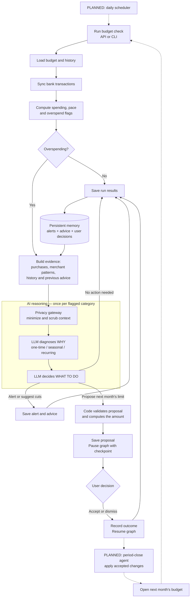
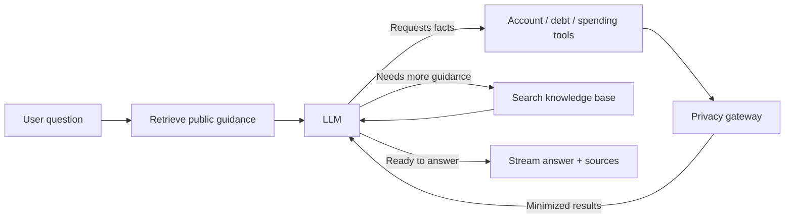
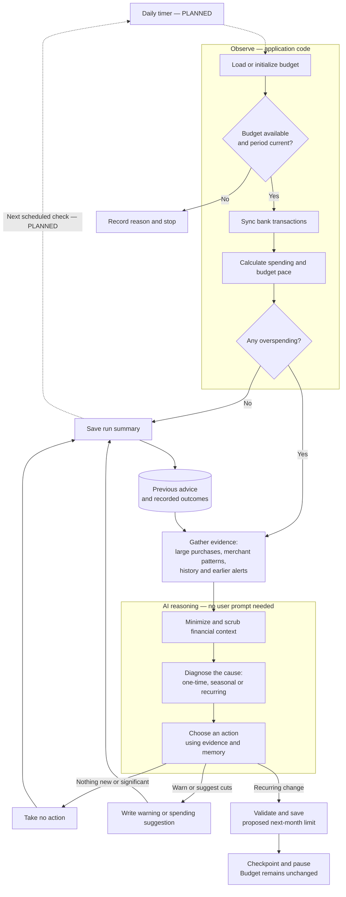
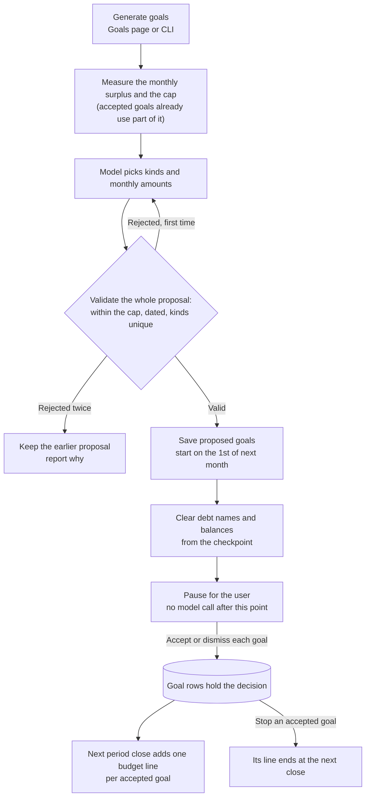
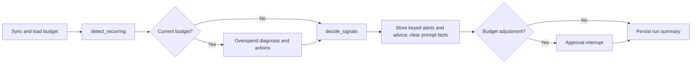

# AI agent pipelines

Saved October 29, 2026. These diagrams focus on the project's agent behavior: gathering evidence, reasoning, selecting actions, and retaining outcomes. Solid arrows show implemented flows; dashed arrows show planned scheduling or period-close integration. They describe the implementation reviewed in this chat, not a guarantee that every later change is reflected here.

## Budget agent: observe, diagnose, decide, act, remember

The budget agent runs through the API or CLI. The main path below assumes a usable budget for the current period. If initialization cannot produce a budget, or the date is past the period's end, the graph records the reason and stops before syncing.

The LLM supplies the diagnosis and action choice. Code computes financial amounts and enforces constraints, including allowing a proposed budget adjustment only for a recurring cause. With a checkpointer, adjustment proposals pause until all of the run's proposals have decisions. Ordinary alerts and suggestions do not pause the graph. Accepting a proposal does not change the current period's limit.

Memory consists of stored alerts, advice, and user outcomes that inform later prompts; it does not retrain the model. Applying accepted proposals to next month's persisted budget and scheduling daily runs remain planned integrations.

Implementation: [budget graph](../backend/app/agents/budget_graph.py), [LLM diagnosis and decision prompts](../backend/app/agents/budget_llm.py), [decision service](../backend/app/budget_service/alerts.py), [existing pure period-close arithmetic](../backend/app/budget_engine/close.py).

## Chat agent: retrieve, reason, use tools, answer

The chat agent begins with a user question, retrieves public guidance, and can repeatedly request financial facts or more guidance before answering. Financial tools read user-scoped data through the privacy gateway. Retrieved public guidance uses local embeddings and Chroma.

The loop permits up to six tool rounds, followed by a model call without tools. The application displays retrieved source links; retrieval alone does not establish that every answer claim is supported. Conversation state persists in the chat checkpoint database.

Implementation: [chat graph](../backend/app/agents/chat_graph.py), [tools](../backend/app/agents/tools.py), [privacy gateway](../backend/app/privacy/gateway.py), [streaming API and history](../backend/app/api/chat.py).

## Autonomous budget check: no user responses during the run

Once started, this flow independently checks spending, investigates problems, chooses a response, and stores advice. Today a run starts through the API or CLI; the daily timer and repeated scheduled execution shown with dashed arrows are planned. A proposed budget change reaches an approval boundary and waits without changing the budget.

The agent can create warnings and spending suggestions without waiting for a user response. They are saved as alerts in the app; this diagram does not imply email or push delivery. Avoiding repeated advice is a model decision informed by memory, rather than a database uniqueness guarantee. Invalid structured replies retry once and then fall back to an ordinary alert; model connection failures mark the run as an error.

Implementation: [budget graph](../backend/app/agents/budget_graph.py), [budget pace calculations](../backend/app/budget_engine/pace.py), [diagnosis evidence](../backend/app/budget_engine/diagnose.py), [structured model calls](../backend/app/agents/budget_llm.py).

## Goal agent: propose, validate, wait for the user, then change the budget

The goal agent starts from the Goals page (or the CLI). Code measures what the user has left each month, the model chooses 1-3 goals and their monthly amounts, and code computes every target and date. The user then accepts or dismisses each goal on its own. Nothing is applied to the month under way: an accepted goal becomes a budget line when the next month opens.

The decision is committed before the paused run is resumed, so a failed resume or a lost checkpoint never loses a click; the run is finished from the rows. A proposal nobody answered expires when the close that opens its start month happens. Without a checkpointer (the CLI) the run doesn't pause, and its goals can still be accepted in the app.

Implementation: [goal graph](../backend/app/agents/goal_graph.py), [decisions](../backend/app/budget_service/goal_decisions.py), [goal lines at close](../backend/app/budget_service/goal_lines.py), [goal routes](../backend/app/api/goals.py), [the design](superpowers/specs/2026-11-02-tpc-25-goal-approval-design.md).

For the broader system, rendered diagrams, and missing pieces, see the [system walkthrough and gap checklist](system-walkthrough.md) and the [architecture](architecture.md).

## Recurring signal path (implemented)

Daily runs refresh stored streams on both the current-budget and no-current-budget routes. Overspend diagnosis remains category-based; recurring signals use their own keys and `decide_signals` node. The first three ranked signals each get one model call without a schema retry; the rest get code-written alerts. All signals have one minimized gateway audit entry. Detector or decision failures record only an exception type and leave overspend checks running.

Cancellation suggestions are ordinary pending alerts. Accepted suggestions mute future signals and reduce the next category line once at close; pending suggestions do not expire. Budget checkpoints save only on exit after signal payloads and prompt facts are cleared. CLI report details remain in process memory. The recurring API, dashboard and sixth chat tool are implemented; the cash forecast is implemented below.

## Cash forecast path (implemented)

Both daily budget routes now run `detect_recurring -> forecast_cash` before overspend or signal decisions. Forecasting is deterministic and adds no model calls on a quiet day. It shares a read-only snapshot with the forecast API and Goal Agent: checking balances, posted checking-only everyday spending, calendar-projected streams, card minimums and accepted goals. The first three ranked signals share the model-call cap; the remaining signals still alert with code-written text.

Low-balance keys identify a bill and dip date. Repeats require +25% and +$20, approaching within two days from three or more days away, or a new dip date beyond the three-day sliding tolerance. A bill remains the attributed cause for a crossing within five days, unless income intervenes, including when it just posted. Neither a buffer change nor a dismissal overrides those repeat rules. Savings and delay-spend suggestions are proposals only, and no paycheck means alert only.

Checkpoint writes filter transient signals and prompt facts even on exceptions; summaries retain dates, ids and flow cents. Goals report forecast versus measured affordability, and the cap uses gross surplus before subtracting commitments once. The replay records absolute error, range coverage and the flat-balance baseline rather than claiming universal interval coverage.
