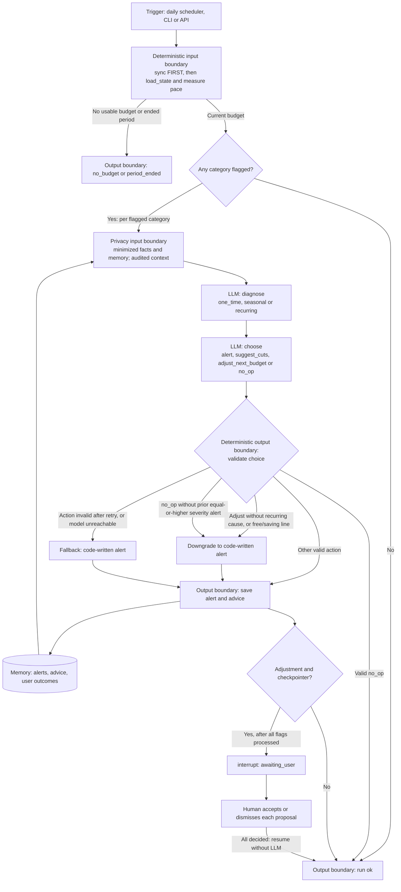
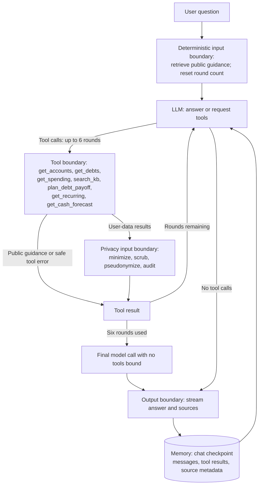
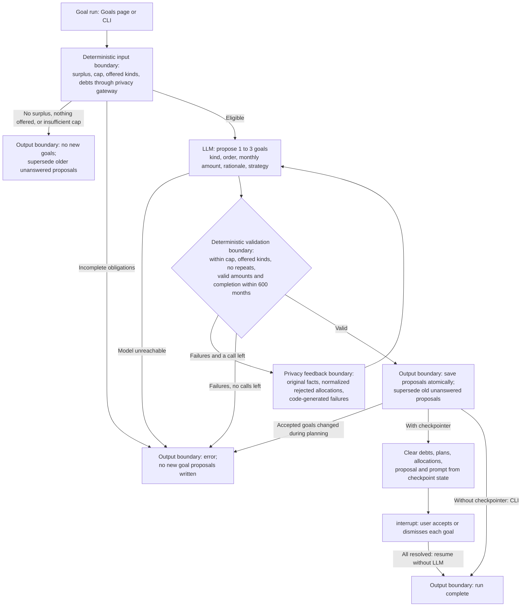
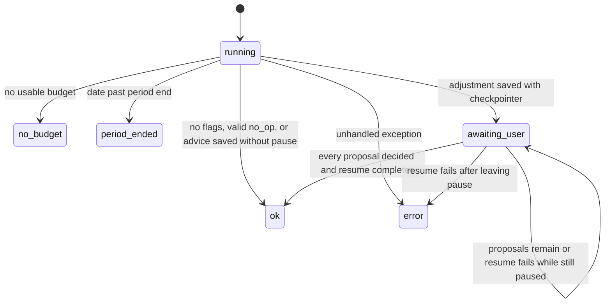
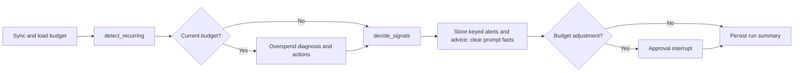

# The agentic system

Reviewed November 2, 2026 against the current agent code and Jira TPC. The chat tools, delivery status, demo trace and evaluation evidence were updated November 3, 2026. Code is the source of truth for behavior; Jira is the source of truth for delivery status. This guide covers agent goals, model decisions, tools, memory, approval, guardrails, and execution. Deterministic services appear only as labeled input/output boundaries. Their arithmetic and storage internals are outside this guide.

## 1. What the agents are for

**Budget agent.** Explain flagged overspending and select a useful response. Given measured evidence and prior outcomes, the LLM diagnoses a cause and chooses an alert, spending suggestion, next-period adjustment proposal, or justified `no_op`. The agent can produce advice without a user prompt, but a budget adjustment requires a human decision.

**Chat agent.** Answer a user's question using financial tools and public guidance. The LLM chooses whether to answer or request tools, selects tool arguments, and can use the results to request more tools. The application retrieves initial guidance independently of that choice.

**Goal agent.** Propose one to three goals within the user's available monthly allocation. The LLM selects goal kinds, ordering, monthly amounts, rationale, and an optional debt strategy. A validation boundary returns failures for one corrective attempt. Valid proposals await individual human decisions.

The shared pattern is **observe → model decision → code-enforced boundary → output or human approval**. Budget and goal graphs have fixed orchestration with model-selected decisions inside it; chat additionally lets the model choose its tool sequence. These are bounded agents, not unconstrained financial operators. No model transfers money or directly changes the current budget. Accepted proposals can affect a future budget through the deterministic period-close boundary.

## 2. Agent decision diagrams

### A. Budget: diagnose, decide, remember

The diagram summarizes per-category reasoning; the graph diagnoses all flags, decides all actions, then saves them before pausing. `sync` precedes `load_state`, including when no budget can be produced. The `categorize` node only counts uncategorized transactions: **LLM categorization is not implemented**. Sync failure can leave the agent checking stored data, so an `ok` result alone does not establish freshness.

Each diagnosis and action call permits one schema-validation retry. A diagnosis failure leaves an unknown cause and still allows the decision step; an invalid or unreachable action call yields a plain alert. Only the known transport/model exceptions handled by `invoke_structured` take this fallback path; other exceptions can fail the run. Code blocks adjustments without a recurring diagnosis or on free/saving lines, and blocks `no_op` without a prior equal-or-higher severity alert. A valid `no_op` writes no alert or advice. The prompt also discourages repeating dismissed adjustments, but that preference is not a hard code constraint.

Evidence: [budget graph](../backend/app/agents/budget_graph.py) (`diagnose`, `decide_action`, `log_advice`, `await_approval`), [structured calls and prompts](../backend/app/agents/budget_llm.py). [PlantUML](diagrams/budget-agent-loop.puml) · [rendered diagram](diagrams/budget-agent-loop.svg).

### B. Chat: choose tools, observe results, answer

The limit is six **rounds**, not six individual calls; a response can request multiple tools. `plan_debt_payoff` lets the model select extra monthly payment and strategy while the tool returns computed results. All six user-data tools use a user-bound privacy gateway; the model does not select a user ID. `search_kb` returns public guidance. Tool argument failures return safe errors the model can react to. Initial retrieval is application-controlled, so it is not evidence of autonomous tool choice. Retrieved source links likewise do not prove every answer claim is grounded.

Chat history persists across turns. User-written messages and history are not fully scrubbed by the financial-data gateway; its audit covers the context it builds, not the entire conversation prompt.

Evidence: [chat graph](../backend/app/agents/chat_graph.py), [seven tool definitions](../backend/app/agents/tools.py), [tool error handling](../backend/app/agents/llm.py), [privacy gateway](../backend/app/privacy/gateway.py). [PlantUML](diagrams/chat-flow.puml) · [rendered diagram](diagrams/chat-flow.svg).

### C. Goals: propose, check, correct, then wait

`MAX_GOAL_CALLS = 2` bounds the entire proposal/correction loop; each proposal call disables the structured helper's internal retry. The feedback contains normalized rejected kinds, amounts and strategies plus validation failures, not the raw reply or rejected rationale. Invalid JSON has no parsed allocations to echo. A failed proposal leaves earlier proposals standing, although the run record and error summary are still written. A successful no-goal outcome withdraws older unanswered proposals. Accepted goals are preserved and reduce the available cap.

With checkpointing, `forget_facts` runs before the approval pause and exit checkpoint is saved. This removes the sensitive planning payload, not every aggregate field or durable goal row. Goal CLI runs have no checkpointer and do not pause; their saved goals remain decidable through the app. No model call follows approval.

Evidence: [goal graph](../backend/app/agents/goal_graph.py) (`propose`, `validate_candidate`, `correction`, `forget_facts`, `await_approval`), [proposal schema](../backend/app/agents/goal_llm.py), [feedback gateway](../backend/app/privacy/gateway.py). [Goal PlantUML](diagrams/goal-agent-loop.puml) · [rendered diagram](diagrams/goal-agent-loop.svg).

### D. Budget run states

`ok` means execution completed, not that the advice was accepted or correct. A paused budget run reads persisted decisions on resume and waits again if any proposals remain. Budget CLI runs now create a SQLite checkpointer, so they can pause too. A direct caller without a checkpointer saves proposals and completes without waiting.

## 3. Capabilities and evidence

| Capability | Implemented behavior | Evidence |
|---|---|---|
| Goal-directed reasoning | Budget diagnosis/action decisions per flag; goal proposal/validation/correction | [budget graph](../backend/app/agents/budget_graph.py), [goal graph](../backend/app/agents/goal_graph.py) |
| Tool use | Chat chooses among seven tools and interprets results over up to six rounds | [chat graph](../backend/app/agents/chat_graph.py), [tools](../backend/app/agents/tools.py) |
| Structured outputs | Budget retries schema failures once per call, then uses bounded fallback behavior | [invoke_structured](../backend/app/agents/budget_llm.py) |
| Self-correction | Goal model receives rejected allocations and specific failures; at most two calls total | [correction](../backend/app/agents/goal_graph.py), [goal_correction](../backend/app/privacy/gateway.py) |
| Memory | Budget reads this period's category alerts and at most five advice/outcome entries spanning this budget month and the preceding three; chat retains conversation state | [`_this_month_alerts`, `_past_advice`](../backend/app/agents/budget_graph.py), [ChatState](../backend/app/agents/chat_graph.py) |
| Human approval | `interrupt()` waits on budget adjustments and individual goal decisions | [budget approval](../backend/app/agents/budget_graph.py), [goal approval](../backend/app/agents/goal_graph.py) |
| Persistence and recovery | Per-run checkpoints; decisions survive failed resume; startup closes abandoned running budget/simulation/goal runs when no unexpired ownership claim exists | [`close_interrupted_runs`](../backend/app/agents/budget_graph.py), [startup](../backend/app/main.py) |
| Guardrails | Enforced action restrictions, user-bound tools, safe errors, goal validation, and bounded loops | [budget rules](../backend/app/agents/budget_graph.py), [tools](../backend/app/agents/tools.py), [goal validation boundary](../backend/app/budget_engine/goals.py) |
| Autonomy | Built daily schedule and same-day startup catch-up, enabled explicitly | [scheduler](../backend/app/scheduler.py), [configuration](../backend/app/config.py) |
| Evaluation | 40 golden scenarios run the real chat, budget and goal graphs, with rule-based checks, including false alarms on no-overspend controls; scripted agent behavior tests | [eval guide](../eval/README.md), [baseline](../eval/results/2026-11-03/qwen2.5_14b/summary.json), [chat tests](../backend/tests/test_chat_graph.py), [budget tests](../backend/tests/test_budget_graph.py), [goal correction tests](../backend/tests/test_goal_validation_graph.py) |

Memory supplies context for inference; it does not retrain the model. Budget duplicate suppression remains partly a model decision, so repeated alerts are possible.

## 4. Approval, recovery, and autonomous execution

Human decisions are committed before graph resume. Budget decisions update alert status and advice outcome; goals record decisions per goal. Both graphs resume without an LLM and wait until all relevant proposals are resolved. Goal recovery can finish from saved rows when checkpoint recovery fails. Startup cleanup does not discard `awaiting_user` runs as abandoned `running` work. Completed budget runs delete their checkpoints; goal cleanup also removes completed checkpoints.

[Approval lifecycle source](diagrams/approval-lifecycle.puml) · [rendered lifecycle](diagrams/approval-lifecycle.svg). The final **deterministic period-close boundary** consumes accepted decisions and emits the next budget. It is implemented in [close_graph.py](../backend/app/agents/close_graph.py), uses no LLM, and is not an additional agent.

The scheduler is **built, opt-in**: `ENABLE_SCHEDULER` defaults false; `1`, `true`, or `yes` enables it. Defaults are 06:00 for daily budget runs and 05:00 on the first of the month for period close, in `America/New_York`. Startup catch-up covers today's elapsed slots, not a replay of every missed day. Simulated and seed-only users are excluded from automatic runs; the demo advances time manually. This documents configuration defaults, not the setting of an already-running server.

For execution, use the [README quickstart](../README.md#quickstart) and [demo walkthrough](../README.md#demo-walkthrough). For a narrated agent trace:

1. Run the planted recurring-overspend example. Identify the input evidence, model diagnosis, selected action, enforced guardrail, and saved proposal.
2. Accept or dismiss it. Show that the run resumes without another model call and that today's limit is unchanged. Treat the later period-close result as a deterministic output boundary.
3. Ask chat "How fast am I debt-free if I add $200 a month?". Show selected tool arguments, returned facts, and the answer. Distinguish automatic retrieval from model-requested tools. In the November 3 baseline this question called `plan_debt_payoff` but the answer left out total interest ([TPC-48](https://ucf-ctcw-senior-design.atlassian.net/browse/TPC-48)). "Which of my debts should I pay off first?" got generic advice with no tool call ([TPC-47](https://ucf-ctcw-senior-design.atlassian.net/browse/TPC-47)), so it isn't a reliable tool trace until that's fixed.
4. Generate goals and show per-goal approval. For reliable correction evidence, use the scripted [goal validation tests](../backend/tests/test_goal_validation_graph.py); a live model may return a valid proposal on its first attempt, so a correction is not guaranteed during a demo.

## 5. Delivery status and gaps

Jira snapshot: November 3, 2026. An implemented path does not imply its ticket is Done: a ticket is Done when its done-when holds and its work is on `main`. At this snapshot, TPC-25, TPC-33, TPC-31 and TPC-26 are in review on branches not yet merged to `main`.

| Work | Jira status | What can be claimed |
|---|---|---|
| [TPC-21](https://ucf-ctcw-senior-design.atlassian.net/browse/TPC-21) scheduling and simulation | Done | Scheduler and catch-up built; autonomy remains opt-in. |
| [TPC-22](https://ucf-ctcw-senior-design.atlassian.net/browse/TPC-22) period close | Done | Implemented deterministic boundary; no model reasoning. |
| [TPC-23](https://ucf-ctcw-senior-design.atlassian.net/browse/TPC-23), [TPC-24](https://ucf-ctcw-senior-design.atlassian.net/browse/TPC-24) goal proposal and validation | Done | On `main`. The code allows one retry (two model calls), where the ticket says up to three. |
| [TPC-25](https://ucf-ctcw-senior-design.atlassian.net/browse/TPC-25) goal approval | In Progress | Implemented; in review. |
| [TPC-32](https://ucf-ctcw-senior-design.atlassian.net/browse/TPC-32) debt planning | In Progress | On `main`, and `plan_debt_payoff` is a chat tool. One done-when isn't met: the chat answer leaves out total interest ([TPC-48](https://ucf-ctcw-senior-design.atlassian.net/browse/TPC-48)). |
| [TPC-42](https://ucf-ctcw-senior-design.atlassian.net/browse/TPC-42) one-command setup | In Progress | On `main`. Following the README on another computer hasn't been done yet. |
| [TPC-33](https://ucf-ctcw-senior-design.atlassian.net/browse/TPC-33) recurring charges | In Progress | Detector, stored streams, signals, API, dashboard card and `get_recurring` are implemented; in review. Real Plaid comparison remains unverified. |
| [TPC-31](https://ucf-ctcw-senior-design.atlassian.net/browse/TPC-31) cash forecast | In Progress | Forecast, low-balance signal, dashboard card and `get_cash_forecast` exist in code. |
| [TPC-16](https://ucf-ctcw-senior-design.atlassian.net/browse/TPC-16) initial chat evaluation | Done | The original five-scenario harness, now extended. |
| [TPC-26](https://ucf-ctcw-senior-design.atlassian.net/browse/TPC-26) golden scenarios | In Progress | 40 scenarios across chat, budget and goal, with one baseline pass on one model. |
| [TPC-27](https://ucf-ctcw-senior-design.atlassian.net/browse/TPC-27), [TPC-28](https://ucf-ctcw-senior-design.atlassian.net/browse/TPC-28) full metrics and charts | To Do | The three-run model comparison and its charts have not been run. Their epic, [TPC-6](https://ucf-ctcw-senior-design.atlassian.net/browse/TPC-6), is In Progress. |
| [TPC-45](https://ucf-ctcw-senior-design.atlassian.net/browse/TPC-45) to [TPC-49](https://ucf-ctcw-senior-design.atlassian.net/browse/TPC-49) agent problems the baseline found | To Do | Open and unfixed; see section 7. |
| [TPC-34](https://ucf-ctcw-senior-design.atlassian.net/browse/TPC-34)–[TPC-39](https://ucf-ctcw-senior-design.atlassian.net/browse/TPC-39) temporal graph and GraphRAG | To Do | Not implemented as agent memory/retrieval. The repository's graphify analysis is a development aid, not runtime agent memory. |
| [TPC-40](https://ucf-ctcw-senior-design.atlassian.net/browse/TPC-40) graph ablations | To Do | Planned comparisons; existing expected-tool checks should not be described as future work. |

Additional limits: categorization is a counting stub; model actions are advice and proposals; user approval does not move money; model-selected answers and rationales can still be wrong. Full comparative and longitudinal evidence remains incomplete.

## 6. Evaluation evidence for the writeup

Use [eval/README.md](../eval/README.md) for commands, metrics, and prerequisites. [40 scenario definitions](../eval/scenarios) run the same graphs and tools as the application, against synthetic users in a throwaway database:

- **Chat (22):** factual checks, answer similarity, judge ratings, expected tool calls, retrieved sources, latency, and errors. Four scenarios test abstention: the data isn't there, so the only right answer says so.
- **Budget (12):** real daily runs over a short window, scored by rule on flags, cause, action, a flag deadline, signals, message text, and low-balance lead time. Four are no-overspend controls.
- **Goal (6):** real goal runs, scored by rule on status, required and banned kinds, priority where the prompt's rule decides it, the cap, and that the model isn't called when nothing is affordable.

### November 3 baseline

The [summary](../eval/results/2026-11-03/qwen2.5_14b/summary.json) is one pass on `qwen2.5:14b` over all 40, with no crashed runs. It's a first baseline, not the model comparison: one pass can't show how often a failure happens, and all the users are synthetic. Its [run configuration](../eval/results/2026-11-03/qwen2.5_14b/config.json) records commit `6ce8567` because it ran before the benchmark itself was committed.

| Kind | Passed | Details |
|---|---|---|
| Chat | 16 of 22 on facts | Judge 82%, expected tools 91%, sources 100%, mean similarity 0.91 |
| Budget | 9 of 12 | Flags 90%, cause 67%, action 100%, false alarms on 1 of 4 controls, alert on the day of the flag, planted low balance warned 6 days ahead |
| Goal | 6 of 6 | Three of these end before the model is called, so they test code. Only three test the model |

Chat pass rate by category: high-interest debt 33%, abstention and spending 75%, subscriptions, cash flow and guidance 100%. Budget by category: one-time, recurring and signals 100%, no-overspend controls 75%, seasonal 0%.

The nine failures are open agent problems, and an earlier pass the same day failed the same nine the same way:

| Ticket | Problem | Scenarios |
|---|---|---|
| [TPC-45](https://ucf-ctcw-senior-design.atlassian.net/browse/TPC-45) | Pace flags weekly and monthly spending with no real overspend. Code decides this, so it happens with any model, and the model then proposed changing next month's budget for one flag | `control-steady-spender` |
| [TPC-46](https://ucf-ctcw-senior-design.atlassian.net/browse/TPC-46) | Spending spread across shops is diagnosed `one_time`, not `seasonal` | `budget-seasonal-holidays`, `budget-seasonal-back-to-school` |
| [TPC-47](https://ucf-ctcw-senior-design.atlassian.net/browse/TPC-47) | "Which debt first" gets generic advice with no lookup, or the right card for the wrong reason. On October 27, `debt-highest-apr` called `get_debts` on all 6 runs, so this may be a regression | `debt-highest-apr`, `debt-none`, `debt-higher-apr-smaller-balance` |
| [TPC-48](https://ucf-ctcw-senior-design.atlassian.net/browse/TPC-48) | Answers misstate or leave out tool figures, such as $1,850 of income when the tool returned $3,700 | `income-last-30-days`, `debt-plan-extra-200` |
| [TPC-49](https://ucf-ctcw-senior-design.atlassian.net/browse/TPC-49) | States a contribution limit for a year the guidance doesn't cover | `abstain-roth-2030` |

Factual checks and judge ratings disagree in both directions, which is a reason to report both. The judge passed `income-last-30-days`, whose figure is wrong, and `debt-higher-apr-smaller-balance` and `debt-plan-extra-200`, which leave out a required figure. It failed `abstain-balance-2019`, whose answer passes the abstain rule.

### What this does and doesn't establish

- **Golden answers are checked against code.** [Offline tests](../backend/tests/test_eval_agents.py) require chat number facts to come from the expected tools, and require code-decided budget and goal outcomes to match with a fake model. A failure above is therefore an agent result, not a typo in a scenario.
- **Model choices and code decisions are separate.** In budget scenarios, flags, deadlines, signals and lead time are code; cause, action and message are the model's.
- **"Unused subscriptions" is limited.** The app has no usage data, so those scenarios have the user say a subscription is unused.
- **Not yet scored:** `tools_none` and allowed-tool checks, `temporal` scenarios, repeat alerts across a full month, and multi-period adaptation.

### Other evidence

An earlier example is the [October 27 qwen2.5:14b summary](../eval/results/2026-10-27/qwen2.5_14b/summary.json), with [run configuration](../eval/results/2026-10-27/qwen2.5_14b/config.json): 15 runs on the original five scenarios, 60% factual pass rate, 80% expected-tool accuracy, 100% judge pass rate, and zero errors. These scores describe that saved run, and aren't comparable as a trend with the larger November set.

The [initial-budget accuracy harness](../eval/budget_accuracy.py) and its [October 28 results](../eval/results/2026-10-28/budget_accuracy/results.json), the [recurring detector results](../eval/results/2026-11-02/recurring_accuracy/results.json) (precision and recall 1.0 on synthetic users), and the [forecast replay](../eval/results/2026-11-02/forecast_accuracy/results.json) (MAE $7.31 at d+7 and $10.07 at d+14, range coverage 68.4% and 79.7%, on one synthetic user) make no LLM calls. They evaluate deterministic boundaries and must not be presented as diagnosis or action-selection accuracy. Scripted [budget](../backend/tests/test_budget_graph.py), goal [validation](../backend/tests/test_goal_validation_graph.py) and [approval](../backend/tests/test_goal_approval_graph.py) tests establish control-flow behavior, not live-model quality.

## Recurring signal path (implemented)

Daily runs refresh stored streams on both the current-budget and no-current-budget routes. Overspend diagnosis remains category-based; recurring signals use their own keys and `decide_signals` node. The first three ranked signals each get one model call without a schema retry; the rest get code-written alerts. All signals have one minimized gateway audit entry. Detector or decision failures record only an exception type and leave overspend checks running.

Cancellation suggestions are ordinary pending alerts. Accepted suggestions mute future signals and reduce the next category line once at close; pending suggestions do not expire. Budget checkpoints save only on exit after signal payloads and prompt facts are cleared. CLI report details remain in process memory. The recurring API, dashboard and sixth chat tool are implemented; the cash forecast is implemented below.

## Cash forecast path (implemented)

Both daily budget routes now run `detect_recurring -> forecast_cash` before overspend or signal decisions. Forecasting is deterministic and adds no model calls on a quiet day. It shares a read-only snapshot with the forecast API and Goal Agent: checking balances, posted checking-only everyday spending, calendar-projected streams, card minimums and accepted goals. The first three ranked signals share the model-call cap; the remaining signals still alert with code-written text.

Low-balance keys identify a bill and dip date. Repeats require +25% and +$20, approaching within two days from three or more days away, or a new dip date beyond the three-day sliding tolerance. A bill remains the attributed cause for a crossing within five days, unless income intervenes, including when it just posted. Neither a buffer change nor a dismissal overrides those repeat rules. Savings and delay-spend suggestions are proposals only, and no paycheck means alert only.

Checkpoint writes filter transient signals and prompt facts even on exceptions; summaries retain dates, ids and flow cents. Goals report forecast versus measured affordability, and the cap uses gross surplus before subtracting commitments once. The replay records absolute error, range coverage and the flat-balance baseline rather than claiming universal interval coverage.
