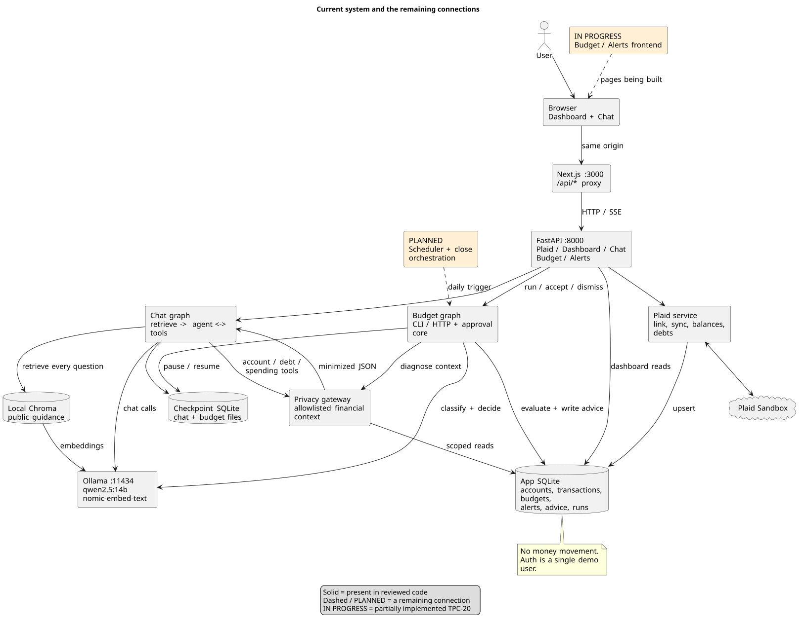

# Architecture: Agentic Financial Dashboard

Term project, agentic track. Author: Armin Delmo (UCF).
Status: living design doc. Update it as you make decisions; the "Decision log" at the bottom is where those go.

This doc is written so you can build the system one milestone at a time. Each section says what the piece does, why it's shaped that way, and what you'll learn building it. Where there was a real choice, the default is stated and the alternatives are listed so you can swap them deliberately.

---

## 1. What we're building

A web dashboard where a user links bank accounts through Plaid, sees balances and debts at a glance, chats with an assistant grounded in their own data, and gets goals they can realistically hit.

The novel part is the **dynamic budget agent**: a scheduled, stateful loop that builds a per-category budget from history, watches spending every day, figures out *why* a category is running hot, decides what to do about it, and adapts the next period's budget. It is agentic because it has:

| Property | Where it lives |
|---|---|
| Persistent state | App DB (budgets, alerts, advice log) + LangGraph checkpointer |
| Autonomous scheduled runs | Scheduler triggers the Budget Agent daily and the Period-Close Agent at period end |
| Multi-step tool use | LangGraph nodes call tools (sync, query spend, search KB, create alert) |
| Adaptive decisions | LLM classifies the cause of an overspend and picks an action; budget is re-fit each period |
| Temporal knowledge | A bitemporal knowledge graph of the user's finances and the finance guidance gives both agents "what was true when" context (section 6b) |

The same daily run also looks past the budget (section 6a). It finds **recurring charges** and flags new subscriptions, price increases and income changes. It **forecasts cash flow** to the next paycheck and warns before the checking balance drops below a buffer. It **plans debt payoff** (avalanche vs snowball, plus what extra monthly payments would change) and proposes extra payments when the forecast shows a surplus. Each of these follows the budget agent's pattern: deterministic code computes, the LLM explains and picks an action, and the user approves anything that touches money.

### Non-goals (for now)
- Real money movement (stretch goal only, section 11).
- Multi-tenant production hardening. One instance, a handful of test users.
- Mobile app.

---

## 2. Diagrams

Start with the [AI agent pipelines](agent-pipelines.md) for the budget decision loop, chat tool loop, and autonomous budget check. The [current implementation walkthrough and gap checklist](system-walkthrough.md) distinguishes implemented, in-progress, and planned behavior. The rendered diagrams below use PlantUML sources in [`diagrams/`](diagrams/), with PNG and SVG beside each source; the agent pipelines use Mermaid embedded in Markdown.

| Diagram | What it shows |
|---|---|
| [`system-design.puml`](diagrams/system-design.puml) | Current components and remaining connections |
| [`plaid-link-sequence.puml`](diagrams/plaid-link-sequence.puml) | Linking, first sync, dashboard reads, and webhook updates |
| [`chat-flow.puml`](diagrams/chat-flow.puml) | Guidance retrieval, financial tools, privacy boundary, and streaming |
| [`budget-agent-loop.puml`](diagrams/budget-agent-loop.puml) | Current budget graph, arithmetic, exits, and approval branch |
| [`approval-lifecycle.puml`](diagrams/approval-lifecycle.puml) | Saved decisions, checkpoint resume, and planned application at close |
| [`data-model.puml`](diagrams/data-model.puml) | Current application tables and separate checkpoint stores |
| [`remaining-lifecycle.puml`](diagrams/remaining-lifecycle.puml) | Planned scheduling, recurring charges, forecast, goals, and rollover |
| [`evaluation-flow.puml`](diagrams/evaluation-flow.puml) | Current evaluations and missing longitudinal validation |

To re-render after editing:

```bash
# needs PlantUML + Java + Graphviz
plantuml -tsvg -failfast2 docs/diagrams/*.puml
plantuml -tpng -failfast2 docs/diagrams/*.puml
# Alternatively, with a standalone PlantUML jar:
java -jar plantuml.jar -tsvg docs/diagrams/*.puml
# or use the PlantUML extension in VS Code (Alt+D to preview)
```



---

## 3. Tech stack

| Layer | Default | Why | Alternatives |
|---|---|---|---|
| Frontend | **Next.js (React, TypeScript)** + Tailwind + Recharts | Plaid ships `react-plaid-link`; Recharts covers balance and budget-pace charts | Vite + React, SvelteKit |
| Backend API | **FastAPI (Python 3.12)** (decided) | LangGraph, ChromaDB and the Plaid Python SDK are all Python, so one language for backend and agents | Node/Express (then agents become a separate service) |
| Agents | **LangGraph** | Explicit state graphs, checkpointing, `interrupt()` for human approval | Plain tool-use loop, CrewAI |
| LLM | **Local Llama via Ollama** (`langchain-ollama` `ChatOllama`), behind a single `llm.py` wrapper. Chat agent model: **`qwen2.5:14b`** (since 2026-10-26; `llama3.1:8b` and `mistral` as benchmark comparisons). Judge model for evals: **`gemma3:12b`** (TPC-16), from a different family than every agent model. Runs on a MacBook Pro M5, 24 GB (70B models don't fit) | Financial data never leaves your machine; free to run thousands of eval calls; wrapper still lets you swap models for benchmarking | A hosted API (Claude, OpenAI) as a comparison baseline |
| Embeddings | **`nomic-embed-text` via Ollama** (decided 2026-10-26), behind `get_embeddings()` in `llm.py` | 8192-token context fits ~500-token chunks; runs on the Ollama server the agent already uses; nothing leaves your machine; same model can score semantic similarity in evals | `all-MiniLM-L6-v2` (Chroma's default, but truncates at 256 word-pieces), `bge-small-en-v1.5` |
| Vector store | **ChromaDB** (persistent client, local dir) | Required by the proposal; zero ops | pgvector |
| Knowledge graph | **Bitemporal graph in the app DB** (`kg_nodes`, `kg_edges`, section 6b) | Same SQLite/Postgres, migrations and tests as everything else; the user half is exact data code can project; no extra service | Graphiti + Neo4j/Kuzu, NetworkX in memory |
| App DB | **SQLite** in dev, **PostgreSQL** later, via **SQLAlchemy 2 + Alembic** | Start simple; migrations keep the schema honest | Supabase |
| Agent state | **LangGraph checkpointer** (`SqliteSaver`, then `PostgresSaver`) | Resumable runs, per-user thread memory | Roll your own |
| Scheduler | **APScheduler** inside the backend | One process, easy to trigger manually in dev | cron + CLI, Celery beat |
| Secrets | `.env` + `python-dotenv`; Plaid access tokens encrypted at rest with `cryptography.Fernet` | Access tokens are the keys to a user's bank data | KMS / Vault |

**Plaid environments:** build entirely in **Sandbox** (fake banks, test users). Plaid retired the old "Development" environment; for real accounts you'd apply for **Limited Production**. Sandbox is enough for the whole project including benchmarks.

---

## 4. Components

Refer to `system-design.png` while reading.

### 4.1 Frontend
- **Dashboard:** net worth, account balances, debts sorted by APR, and a **Budget** card with one pace bar per line (TPC-20).
  - The bar fills with the share of the limit spent, and a marker shows how much of the month has passed.
  - Colours: amber when the agent flags it for pace, red over the limit, neutral otherwise.
  - The numbers come live from `GET /budget`. Unbudgeted spending is listed under the bars.
  - The header links to Alerts, with the pending count.
- **Plaid Link widget:** `react-plaid-link`. Gets a `link_token` from the backend, returns a `public_token`. Bank credentials go to Plaid only.
- **Chat UI** (`/chat`): streams tokens over Server-Sent Events from `POST /api/chat`. Shows which tools the agent called (✓/✗ chips) and lists the guidance it was given as clickable sources.
- **Simulation panel** (on `/alerts`, TPC-21; only with `ENABLE_ADMIN` and a simulated user): the simulated date, **Advance 1 day**, **Advance 7 days** and **To month end**, with "Day N of M…" progress and the result.
- **Alerts** (`/alerts`, TPC-20):
  - **Run budget check** (an optional date; blank means today) starts a run in the background, then polls it every 2 s. It reports alerts written, waiting for approval, no budget, or failed.
  - **Pending** alerts have Accept / Dismiss; decided ones are listed under **History**.
  - A budget proposal shows the limit the user would accept, and says when a paused run is waiting on it.
  - Decisions are written back as the advice's outcome, which is the agent's memory.
- **Goals:** proposed goals with Accept / Dismiss (M4).
- **Recurring charges:** subscriptions and bills the agent found, with frequency, typical amount, next expected date and a badge for new or price-increased ones.
- **Cash-flow forecast:** projected checking balance per day to the next paycheck, as a line with a low/high band, the buffer as a reference line, and markers on the days bills land.
- **Debt payoff:** avalanche vs snowball side by side (months to debt-free, total interest, payoff order), with an "extra per month" input that recomputes both.

### 4.2 Backend API (FastAPI)
- **Auth & Session:** keep it simple: email + password with hashed passwords (or a single demo user). Every row in the DB is scoped by `user_id`.
- **Routes:** see section 9.
- **Plaid Service:** the only module that talks to Plaid. Wraps link token creation, token exchange, `/transactions/sync`, `/accounts/balance/get`, `/liabilities/get`, and webhook handling.
- **Privacy Gateway:** the only module that builds LLM prompts from user data. Section 7.
- **Local LLM (Ollama):** runs on the same machine as the backend at `http://localhost:11434`. No API key.
- **Scheduler:** registers per-user jobs: daily sync + budget run (which also refreshes recurring streams and the cash-flow forecast, section 6a); period close.

### 4.3 Agent layer (LangGraph)
Four graphs, sharing one tool set:

| Graph | Trigger | Shape |
|---|---|---|
| **Chat Agent** | User message | Retrieve guidance for the question, then a ReAct loop: LLM ↔ tools until it answers (at most 6 tool rounds, then one last call without tools) |
| **Budget Agent** | Daily schedule | Fixed pipeline with one LLM branch (diagnose + decide). Also detects recurring charges and forecasts cash flow (section 6a). See `budget-agent-loop.png` |
| **Period-Close Agent** | Period end (and the first daily run after it) | No LLM: `load_period → expire_proposals → gather → adapt → persist`, looping while another month is due. Compares budget vs actual, applies accepted proposals, smooths the rest, applies the budget style and opens the next period (section 6.5, TPC-22) |
| **Goal Agent** | User request or after period close | Gather debts, income and the forecast's surplus → run the debt-payoff planner → propose goals → user approves via `interrupt()` |

**Deterministic Budget Engine:** plain Python functions for totals, pace, thresholds and budget fitting, plus recurring-stream detection, the cash-flow forecast and the debt-payoff simulation (section 6a). The LLM never does arithmetic that matters. This is a core design rule: it makes the system testable and keeps the benchmarks meaningful.

### 4.4 Knowledge base (RAG)
ChromaDB collection `fin_guidance`, filled by an offline ingestion script from curated public sources (section 8). The `search_kb` tool returns top-k chunks with source URLs so answers can cite them.

### 4.5 Evaluation harness
Offline Python package that replays scenarios against the agents and computes metrics (section 10).

---

## 5. Data model

Start with these tables (SQLAlchemy models). Amounts are stored as integer cents to avoid float errors.

```
users            id (uuid), email, password_hash, created_at, prefs_json
plaid_items      id, user_id, plaid_item_id, access_token_enc, institution_name,
                 txn_cursor, status, created_at
accounts         id, user_id, item_id, plaid_account_id, name, mask, type, subtype,
                 current_balance_cents, available_balance_cents, limit_cents, updated_at
liabilities      id, user_id, account_id, kind (credit|student|mortgage), apr,
                 min_payment_cents, next_due_date, balance_cents
transactions     id, user_id, account_id, plaid_txn_id (unique), date, amount_cents,
                 merchant_name, pf_category_primary, pf_category_detailed,
                 our_category, user_category, is_recurring, pending, removed
budget_periods   id, user_id, start_date, end_date, status (open|closed), fit_json,
                 income_cents, total_cents, created_at
                 unique (user_id, start_date)
budget_lines     id, period_id, category, name, group (needs|wants|saving|free),
                 kind (fixed|flexible), limit_cents,
                 spent_cents, last_pace, source (init|adapted|user), fit_json
                 unique (period_id, category)
alerts           id, user_id, period_id, kind (overspend|new_subscription|price_increase|
                 income_change|low_balance|extra_payment), category, severity,
                 cause (one_time|seasonal|recurring), action (alert|suggest_cuts|
                 adjust_next_budget|suggest_cancel|move_from_savings|delay_spend|extra_payment),
                 stream_id, message, status (pending_user|accepted|dismissed), created_at
advice_log       id, user_id, run_id, category, advice_text, created_at, outcome
goals            id, user_id, kind (debt_payoff|savings|emergency_fund), target_cents,
                 target_date, monthly_cents, strategy (avalanche|snowball, debt_payoff only),
                 rationale, status
recurring_streams id, user_id, direction (in|out), merchant_key, merchant_name, category,
                 frequency (weekly|biweekly|semi_monthly|monthly|annual), typical_cents,
                 last_cents, amount_varies, first_date, last_date, next_date,
                 status (active|stale), first_seen_run_id, updated_at
agent_runs       id, user_id, graph, started_at, finished_at, status, summary_json
category_rules   id, user_id, merchant_name (trimmed, casefolded), category, created_at
                 unique (user_id, merchant_name)
```

TPC-19, TPC-20 and TPC-21 additions:
- `agent_runs.graph` is also `simulate` (an advance job, with its progress in `summary_json`) and `close` (one row per month closed, TPC-22; `ok` or `error`, none when nothing was due).
- `users.prefs_json["sim"] = {"profile", "date"}` marks a synthetic user living on a simulated date (TPC-21). The date is "today" for that user's dashboard and runs. The scheduler skips them.
- `alerts.proposed_limit_cents`: set by code for `adjust_next_budget`.
- `advice_log.alert_id` (FK): the alert the advice became, so the user's decision reaches it as `outcome`.
- `agent_runs.status` adds `awaiting_user`: a run paused on a budget proposal.

TPC-22 additions:
- `budget_lines.name` is the user's label; `budget_lines.group` is what the rules read. `category` stays the internal key for what the line tracks: a Plaid category, `SAVINGS_TRANSFER` (the saving line) or `FREE` (the free line). Existing lines were backfilled from the default mapping.
- `budget_periods.income_cents` (typical monthly income, `null` with no income history) and `total_cents` (the planned total). `null` on periods from before TPC-22.
- `transactions.user_category`: the user's correction, which wins over everything else. `category_rules` remembers a correction for a merchant.
- `users.prefs_json["budget"] = {"style": "caps" | "50_30_20", "targets": {"needs", "wants", "saving"}}`; missing means `caps` at 50/30/20.
- `agent_runs.status` adds `expired`: a budget run paused on a proposal its month closed without.
- Alert kinds add `over_income` and `group_over_target`, written by close as plain `alert`s.

Notes:
- `plaid_txn_id` is unique so re-syncing is idempotent (upsert).
- `/transactions/sync` returns `added`, `modified`, `removed`; handle all three. Pending transactions get replaced by posted ones with a new id.
- Plaid amounts are **positive for money leaving the account**.
- **Budget tables (TPC-18):** `budget_periods.fit_json` holds the months fitted and the categories skipped (`null` for a period opened by period close). `budget_lines.fit_json` holds the monthly totals and the outlier months, with their top transactions, behind each limit. The unique constraints mean a re-run or a race can never create two budgets for one month or two lines for one category. Alert `kind`, `cause`, `action`, `status` and `severity` and `advice_log.outcome` are plain strings, so a new kind needs no migration (the allowed values are `Literal`s in `models.py`). `alerts.stream_id` arrives with `recurring_streams` (TPC-33).
- **Sign convention (decided):** `transactions.amount_cents` keeps Plaid's sign as-is: **positive = money out** (purchases, bills, transfers out), **negative = money in** (paychecks, refunds, transfers in). Store Plaid's amount converted to cents without flipping it. When summing spending for a category, add up the positive amounts, and flip the sign only when displaying.

---

## 6. The dynamic budget agent (Milestone 3, the core)

### 6.1 State

```python
class BudgetState(TypedDict):
    user_id: str
    period_id: int
    today: date
    new_txns: list[dict]            # from sync
    totals: dict[str, int]          # category -> spent_cents this period
    flags: list[OverspendFlag]      # from detect_overspend
    diagnoses: list[Diagnosis]      # LLM output, structured
    actions: list[Action]           # LLM output, structured
    period_ended: bool
```

Each node takes the state and returns a partial update. That's the whole LangGraph model; once this clicks, the rest is wiring.

### 6.2 Nodes

| Node | LLM? | Does |
|---|---|---|
| `load_state` | no | Load open period, budget lines, recent advice |
| `initialize_budget` | no | Only if no budget exists. See 6.3 |
| `sync_transactions` | no | Call Plaid Service sync, upsert rows |
| `categorize` | rarely | Use Plaid's primary `personal_finance_category` as the budget category (decided); send only uncategorized/ambiguous merchants to the LLM |
| `update_totals` | no | Recompute `spent_cents` per line |
| `detect_overspend` | no | See 6.4 |
| `diagnose` | **yes** | For each flag: classify cause as one-time / seasonal / recurring, with evidence |
| `decide_action` | **yes** | Pick `alert`, `suggest_cuts`, `adjust_next_budget`, or `no_op`; must check `advice_log` to avoid repeating itself |
| `log_advice` | no | Write alerts + advice_log |
| `close_period` | some | Section 6.5 |
| `persist_state` | no | Write `agent_runs` row |

Use **structured output** (Pydantic models) for `diagnose` and `decide_action` so the graph can branch on the result and the benchmarks can score it.

**As built (TPC-19):** `agents/budget_graph.py`.
- **Running it:** `run_budget(session_factory, user_id, today)` runs `sync → load_state → categorize → update_totals → detect_overspend → diagnose → decide_action → log_advice → persist_state`. Sync comes first so a user's first budget is fit on fresh data (it was after `load_state`, so a user with no budget yet was never synced). It skips straight to `persist_state` when there is no budget yet (`no_budget`), when today is past the open period (`period_ended`, left for close), or when nothing is flagged.
- **State:** plain values (ids, ISO dates, dicts), which LangGraph checkpoints in `data/budget_checkpoints.db` (`BUDGET_CHECKPOINT_PATH`), thread `budget-<run_id>`.
- **Memory (TPC-20):** for each flag, code reads two facts, which pass through the gateway and never carry message text:
  - `this_month_alerts`: this period's earlier overspend alerts for the category, as severity, action and status;
  - `past_advice`: the category's advice from this budget month and the 3 before it, as month, action and outcome.

  The decide prompt opens with the memory check: if the category was already alerted this month and the severity isn't higher, `no_op`; never re-propose a dismissed adjustment. Code adds a one-line summary ("Earlier alerts for this category this month: 1, highest severity high"). The model makes the call, but code enforces the floor: a `no_op` stands only when an earlier alert this month was at least as severe. Otherwise it becomes the code-written alert (`escalated`), so the model can never hide an overspend.
- **Diagnosis:** for each flag, `budget_engine/diagnose.py` computes the facts:
  - the largest purchase and its share;
  - its ratio to that merchant's usual month;
  - each top merchant's spend this month, how many of the earlier history months it appeared in, with its typical amount, and its `pattern`. The pattern is judged only over the history months the user has data for (a user who linked in September has one): `new` (never seen), `regular` (every month), `started_recently` (only the latest months, in a row) or `occasional` (some earlier month, but not in a run up to the latest);
  - the history and outlier months from `fit_json`;
  - the projection and the proposed limit.

  The gateway turns them into the prompt (purpose `diagnose`, section 7). `agents/budget_llm.py` asks for a `Diagnosis {cause, evidence}`, then an `Action {action, message}`.
- **Structured output:** `invoke_structured` binds Ollama's `format` to the model's JSON schema, validates with Pydantic and retries once. If it still fails, or the model can't be reached (Ollama down, a timeout), the overspend is still alerted: with no cause, or with a message written by code. An unreachable model isn't retried, and any other exception still fails the run.
- **Writing results:** `log_advice` writes an `overspend` alert (`pending_user`, severity `high` over the limit, `medium` on pace) and an `advice_log` row for every action except `no_op`.
- **`adjust_next_budget`:**
  - It is allowed only for a **recurring** cause. The code downgrades any other cause's adjust to an `alert` with its own message, and the decide prompt only offers a proposal for a recurring cause.
  - The alert carries `proposed_limit_cents`, computed by code, never by the model: the category without its recently started merchants plus their typical month (with none, the projection), rounded up to $5. "Without" is the old limit, or the history months' median × 1.05 minus those merchants when that's lower, so a merchant already in the median isn't counted twice. A fixed line's proposal is its actual amount, rounded up to $5 too.
- **`categorize`** only counts uncategorized transactions for now; LLM categorization is a follow-up.
- **Recording the run:** every run writes an `agent_runs` row (`running` → `ok`/`no_budget`/`period_ended`, or `error` with the exception type). Its summary holds the flags, causes, actions, alert ids, unbudgeted categories, uncategorized count, sync result and LLM failures.
- **Live result (`qwen2.5:14b`):** the four planted users in `eval/budget_users.py` (`PLANTED`) get the right cause and an allowed action twice in a row:
  - one-time: `alert`;
  - recurring: `adjust_next_budget`, proposing $135;
  - seasonal: `suggest_cuts`;
  - a $520 one-off at a regular shop: `one_time`, `alert`.

### 6.3 Initial budget (from ~90 days of history)

When creating the Plaid link token, set `transactions.days_requested` to at least 180: the budget uses the last 90 days, and recurring detection (section 6a.1) needs longer to catch monthly streams reliably.

The maths is `budget_engine/fit.py` (`fit_budget`), a pure function over the transactions and `today`. The shared spending filter and month helpers are in `budget_engine/txns.py`.

1. Drop transfers, income, and credit-card payments (they're not spending; they'd double count). Refunds are **netted** within a category (purchases − refunds, floored at $0): a returned purchase isn't spending.
2. Mark **fixed** categories (rent, utilities, loan payments, insurance, and subscriptions found by the recurring detector in section 6a.1). Budget = the **lower median of the months that had the bill**, with no markup. Rent paid a day early puts two rents in one month and none in the next (`$1,500 / $3,000 / $0`); the result is still one rent. Months with no payment (before a new lease, or the month after an early payment) don't count, and the lower median keeps an even count (`$1,500 / $3,000`) from averaging one rent with two. A rent increase is adopted at period close, where a fixed line follows the actual amount. **Early-paid bills:** a fixed category's charge in a month's last 3 days, within 10% of its usual bill, counts toward the next month (`shift_early_bills` in `txns.py`), so rent paid on Aug 31 for September is September's. Fit's usual bill is the lower median of each month's largest charge in the category. Pace and close use the line's limit.
3. For **flexible** categories, compute monthly totals for each of the last 3 **complete** calendar months (the current partial month is never fitted; shorter history uses fewer months). The first month of history counts only if its earliest transaction is on day 1–3; history that starts later covers part of that month, which would drag every median down. Budget = **median** × 1.05. Median, not mean, so one vacation doesn't inflate the budget. A flexible category whose median is $0 (an occasional purchase) gets no line and is listed as skipped, since a $0 limit would flag every time.
4. Store the outliers so the agent can explain the budget. An outlier is a **month** above 1.5× the category median, kept with its 3 largest transactions ("Travel was $1,900 in August and was left out"). It's for explanation only; the median is unchanged.

**Storing it (TPC-18):** `budget_service/initialize.py` (`initialize_budget`) loads the user's non-removed transactions (an LLM-assigned `our_category` wins over Plaid's), fits them, and stores an open period for the current month with one `init` line per fitted category. The evidence goes in `fit_json`. It runs only when the user has no period at all; opening later months is period close's job. It commits (like `sync_transactions`), so call it with nothing else pending. If two runs race, the loser returns the winner's period; any other integrity error is raised. With no complete month of history (or every category skipped) it writes nothing and returns `None`, so the next run tries again.

**The full model (TPC-22):** a transaction's category resolves as the user's correction, then their merchant rule, then `our_category`, then `SAVINGS_TRANSFER` for Plaid's `TRANSFER_OUT_SAVINGS`, then Plaid's primary category (`resolve_category`, the one place that decides). The fit also returns:
- a **saving** line (fixed, `group="saving"`): the lower median of the months with a transfer to savings;
- **income**: the median month of `INCOME` over the fit window, or `None` when that median is $0;
- a fallback total: the median month of total spending × 1.05, for users with no income.

Each line gets a default group (`needs`: rent and utilities, loan payments, transportation, medical, food and drink; `wants`: other spending) and name ("Food and drink"). Then `budget_engine/styles.py` (`apply_style`) sets the free line and the total:
- **`caps` (default):** `total = max(income or fallback, sum of lines)`; **free** = total − the other lines, never below $0. Lines over income raise `over_income` (only when income is known).
- **`50_30_20`:** needs, wants and saving targets as percentages of income; the saving line is its target; free is the room left in wants; a group over its target raises `group_over_target`. Without income it runs as `caps` and says so.

Code never cuts a line the user didn't ask to cut. The eval scores only needs/wants lines, so its numbers are unchanged.

**Median vs mean (measured, TPC-18):** on the five synthetic budget users, pooled initial-budget MAPE is **7.1% for the median and 17.7% for the mean**. The mean is 1-2 points better on users with no outliers, but 58.8% vs 9.4% on the user with a $1,900 trip, and it gives a one-off purchase a line that the next month can't use. The median stays. A trimmed mean is the median at 3 months. Run it with `venv/bin/python eval/budget_accuracy.py` (section 10).

### 6.4 Overspend detection

Budget periods are **calendar months** (decided). `days_in_period` is the length of the current month.

```
elapsed_fraction = days_elapsed / days_in_period
pace = spent / (limit * elapsed_fraction)
flag if pace >= 1.10 and days_elapsed >= 5     # flexible categories
flag if spent > limit                          # any category, any day
```

The `days_elapsed >= 5` guard avoids flagging on day 1 because of one grocery trip. Fixed categories are lumpy (rent lands on the 1st), so judge them only against their limit, not pace. Next month's bill paid early (see 6.3) doesn't count toward this month, so it never raises a false over-limit alert. Tune these thresholds with the benchmark, then record the chosen values in the decision log.

This is `budget_engine/pace.py` (`evaluate`). Spending in a category with no budget line is reported to the graph as `unbudgeted` and never flagged on its own. With a free line (TPC-22), that spending, plus anything corrected to Free, counts against free, which is judged like any flexible line; its diagnosis looks at those purchases. A saving line is never flagged: it shows what was saved so far. Free and saving lines never get `adjust_next_budget` (downgraded to `alert`): free is computed and saving can't be overspent.

**Known false alarms (found in TPC-19):** pace is unfair to lumpy flexible spending. On Aug 20, a steady synthetic user with no real overspend flags:
- ENTERTAINMENT at 1.48, because a $15.99 subscription is charged on day 5;
- TRANSPORTATION at 1.12, because of how many Mondays had passed.

TPC-33 moving subscriptions into the fixed set fixes the first. The thresholds are tuned in M5 against the false-alarm metric.

### 6.5 Period close and adaptation
At the end of each calendar month: for each line, compare `limit` vs actual. Apply any `adjust_next_budget` actions the user accepted. For lines without an action, nudge toward actual with smoothing: `new = 0.7 * old + 0.3 * actual`, clamped to ±15% per period. This keeps the budget from chasing one bad month. The "does the budget improve over time" benchmark checks this works.

This is `budget_engine/close.py` (`close_period`):
- An accepted value is used as-is, with no clamp.
- A **fixed** line follows the actual amount (a rent increase is adopted, not smoothed toward), and keeps its old limit when the actual is $0.
- `period_actuals` computes each category's actual for a month with the 6.3 early-bill rule, so next month's rent paid early can't be adopted as a doubled limit. Period close (TPC-22) calls it.
- Amounts round half up to the cent.

**As built (TPC-22):** `agents/close_graph.py`, with its steps in `budget_service/close.py`. `close_due(session_factory, user_id, today)`:
1. **`load_period`:** the oldest open period that ended before today. None (no budget yet, or already closed) → nothing is written.
2. **`expire_proposals`:** `adjust_next_budget` alerts still `pending_user` on that period (written in step 5).
3. **`gather`:** the month's actuals per line (free's is the spending without a line, saving's the transfers to savings), accepted proposals (the latest per category wins), income as of the new month and the user's style.
4. **`adapt`:** `close_period` over needs, wants and saving lines, a saving line added if the month had transfers and the period had none, then `apply_style`.
5. **`persist`:** one commit: expired alerts `dismissed` (advice `ignored`, paused runs `expired`), the old period `closed`, the next one opened with each line's name and group carried and `fit_json = {old_cents, actual_cents, rule}` (`source="user"` for an accepted value), style alerts on the new period, and an `ok` run whose summary lists every line.

Then it loops, so missed months close one at a time from their own actuals. The `(user_id, start_date)` constraint makes a rerun or a race write nothing; any other failure rolls the month back and records an `error` run, and the next run retries. Every daily run (scheduler, button, simulated day) calls `close_due` first.

### 6.6 Human in the loop
Anything that changes the user's money or their budget without being asked goes through LangGraph's `interrupt()` and becomes an alert with status `pending_user`. The agent proposes; the user disposes.

**As built (TPC-20):**
- **Pausing.** A run that wrote any `adjust_next_budget` alert goes to `await_approval`, which waits on `interrupt({"waiting_for": [alert ids]})`. The run reads `awaiting_user`. Plain `alert` and `suggest_cuts` alerts don't pause.
- **Deciding.** `budget_service/alerts.py` `decide_alert`:
  1. commits the decision on the alert, and as the outcome on its advice rows, in one conditional update (`WHERE status = 'pending_user'`), so two requests for one alert can't both pass the check;
  2. then resumes the run with `Command(resume=[alert_id, decision])`. A pair, because LangGraph reads a dict resume value as interrupt id → value. No model is built: nothing after the pause calls one.

  Decisions can arrive in any order. The run finishes once all are in, recording them in its summary. If the resume fails, the decision is still saved, and the run stays `awaiting_user`.
- **The alert rows are the source of truth.** `await_approval` reads each proposal's status from its alert row, and treats a resume as a prompt to look again. So a decision still counts if no resume reached the run: the resume failed, the click landed before the run was marked `awaiting_user`, or two decisions raced. Resumes for one run take a per-run lock. Any paused run whose proposals are already decided is resumed in three places: after `run_budget` marks it `awaiting_user`, after every decision, and whenever `GET /alerts` loads.
- **Failures and restarts:**
  - A resume that fails while the thread is still paused leaves the run `awaiting_user`; only a run that got past the pause and then failed is `error`.
  - A new run id clears any old checkpoint thread first, because SQLite reuses deleted run ids.
  - A run deletes its checkpoint thread when it finishes. Only a paused run keeps one, because the state holds unscrubbed facts.
  - `GET /budget/runs/{id}` reports a paused run whose checkpoint is missing or unreadable as `error`, instead of failing or saying it's waiting on 0 proposals.
  - At startup, budget runs left `running` by a stopped server become `error` ("Interrupted").
- **Who starts a run (TPC-21):** the daily scheduler, the run button and each simulated day all go through `budget_service/daily.py` `run_daily`, behind one per-user lock, so they never overlap.
- **Applying (TPC-22).** Close applies an accepted `proposed_limit_cents` exactly. A proposal still undecided when its month closes expires: the alert is `dismissed`, its advice outcome `ignored` (the user never answered, unlike `dismissed`), the paused run `expired`, and a later decision gets a 409.

---

## 6a. Beyond budgeting: recurring charges, cash flow and debt payoff (Milestones 3-4)

Three more jobs the agent does without being asked. They are built like the budget agent: a pure function in `budget_engine/` does the math and is unit-tested, the LLM only explains the result and picks an action, and every action that touches money or the budget becomes a `pending_user` alert (section 6.6). They feed each other:

```
recurring streams ──► cash-flow forecast ──► monthly surplus ──► debt-payoff planner
       │                     │                                        │
       └── new / changed     └── low-balance warning                  └── extra-payment proposal
```

### 6a.1 Recurring-charge detection

**Detector** (`budget_engine/recurring.py`), run over our own `transactions` table:
1. Take posted, non-removed transactions from the last 180 days. Group them by direction (money out or in) and a normalized merchant key: lowercased, with digits and punctuation removed, so `NETFLIX.COM 8443` and `Netflix.com 1123` match.
2. A group is a stream when it has at least 3 transactions whose gaps cluster around 7, 14, 15 (semi-monthly), 30 or 365 days. The median gap must fall within ±3 days of the target, or ±5 for monthly, because bills shift around weekends and short months.
3. If every amount is within 10% of the median, the stream is **fixed** and `typical_cents` is that median. Otherwise it's marked `amount_varies` (utilities, for example) and `typical_cents` is the median of the last 3 amounts.
4. `next_date = last_date + median gap`. A stream that misses two expected dates becomes `stale`.

**Why our own detector instead of Plaid's `/transactions/recurring/get`:** the synthetic eval users are loaded straight into the DB and never touch Plaid (section 10.1). The detector has to work on our table for the benchmarks to mean anything. A pure function is also easy to unit test, and Plaid's recurring endpoint is a separately priced add-on outside Sandbox. In Sandbox, compare our streams with Plaid's as a sanity check and report the agreement.

**What the daily run does with them:** it upserts streams into `recurring_streams` and compares them with the last run.

| Change | Rule | Alert `kind` |
|---|---|---|
| New outflow stream | First detected in this run | `new_subscription` |
| Price increase | Fixed stream whose `last_cents` is at least 5% and $1 above `typical_cents` | `price_increase` |
| Income change | An inflow stream (paycheck) that went stale, or whose last amount is 10% or more below typical | `income_change` |

The LLM (inside `decide_action`, section 6a.4) writes the message and picks `alert` or `suggest_cancel`. The app can't cancel a subscription itself. Accepting `suggest_cancel` lowers next period's budget line for that category and stops future alerts on the stream. Recurring streams also help `diagnose`: an overspend that comes from a stream first seen this period has cause `recurring`.

**Privacy:** the gateway gets a new purpose, `recurring`, that sends the scrubbed merchant name, category, frequency, amounts and dates. Inflow descriptions often contain an employer's or a person's name, so inflow streams go out as category and amount only (`"INCOME, biweekly, $1,850"`).

### 6a.2 Cash-flow forecast

**Forecast** (`budget_engine/forecast.py`), a pure function from a snapshot of the DB to a list of days:
- **Start:** the summed `available_balance_cents` of depository checking accounts, falling back to `current_balance_cents`.
- **Scheduled events:** active recurring streams on their `next_date` (repeated across the horizon), plus each credit card's `min_payment_cents` on its `next_due_date` if no outflow stream already covers that card's payment.
- **Everyday spending:** the daily total of money out that isn't a recurring stream, over the last 90 days. The expected path uses the median day, the low path the 75th-percentile day and the high path the 25th.
- **Horizon:** through the next paycheck, and at least 30 days.

**When it acts:** if the *low* path dips below the buffer within 14 days, the run raises a `low_balance` flag with the date, the shortfall and the events on that date. The buffer is `users.prefs_json.low_balance_buffer_cents`, default $100. The LLM names the bill that causes the dip and picks one of these actions:
- `move_from_savings`: amount = shortfall + buffer, only if a savings account can cover it. It is a proposal only; nothing moves (section 11).
- `delay_spend`: names flexible categories that are ahead of pace (section 6.4) and how much to hold back.
- `alert`: warns without suggesting anything.

**Surplus:** expected balance at the next paycheck, minus the buffer, minus scheduled events before the paycheck after it. Scaled to a month, this is `monthly_surplus_cents`, the figure the Goal Agent and the debt planner use. It replaces M4's separate surplus calculation.

**Limits, stated in the UI:** with irregular income there's no inflow stream, so the forecast assumes no income and says so. The answer is always shown as a range, never a single number.

### 6a.3 Debt-payoff planner

**Simulation** (`budget_engine/payoff.py`, TPC-32): `simulate(debts, extra_monthly_cents, strategy, *, start) -> Plan`, month by month, in integer cents. `compare` runs both strategies with the extra and again with $0, the baseline.
1. Interest each month = balance × APR / 12, rounded to the cent. Cards really compound daily on the average daily balance; monthly is close enough for planning, and the simplification is documented.
2. Every month pays one budget: the extra plus every included debt's original minimum. Minimums go first, each capped at what the debt owes. The rest goes to the target: highest APR for **avalanche** (ties by `avalanche_key`), smallest balance for **snowball** (then higher APR). What's left after clearing a debt spills to the next target that month. So a paid-off debt's minimum, and the unused part of a minimum bigger than its balance, roll over (that's what makes both methods snowball).
3. Hold minimums at Plaid's current figure. Real card minimums shrink as the balance drops, so this is the conservative choice; say so in the output.
4. Stop when every balance is 0 or after 600 months. Any debt still open then is in `never` (its minimum doesn't cover its interest and nothing else reaches it), and the plan has no debt-free date.
5. Debts with no APR or no minimum payment are left out and listed with the reason; the planner never invents either. Mortgages are left out unless `include_mortgage=True`. A 0% APR is a real rate and is planned. A balance of $0 or less (an overpaid card) is skipped silently.
6. The plan starts on the 1st of next month. The balance is the account's current balance, the same number as the dashboard's, through one loader (`budget_service/debts.load_debts`) shared by the API and the gateway.

The output gives each strategy's months to debt-free, total interest, and payoff order with dates, plus the difference an extra amount makes ("+$200/mo: 14 months sooner, $1,930 less interest").

**Where it's used:**
- **Chat:** a `plan_debt_payoff(extra_monthly, strategy)` tool, going through the gateway with a new `debt_plan` purpose. It returns computed results only, with names scrubbed, so the model never does the amortization itself.
- **Goal Agent (M4):** proposes a `debt_payoff` goal whose monthly amount fits within part of `monthly_surplus_cents`, with the strategy chosen and explained. The `cfpb-reduce-debt` KB page covers both methods.
- **Daily run:** if a debt-payoff goal is accepted and the forecast shows more surplus than the goal assumed, propose an `extra_payment` alert. It is a proposal only.

**Benchmark value:** every question has an exact answer, so the eval can check the agent's numbers by rule (months match, interest within $1) instead of with a judge. The `debt-plan-extra-200` scenario does that, with its facts generated from the planner (and a test that fails if they drift).

**Live (TPC-32, `qwen2.5:14b`, 2026-11-01):** "How fast am I debt-free if I add $200 a month?" on the `debt-highest-apr` user (a $3,200 card at 24.99% and an $18,400 loan at 5.5%). The model called `plan_debt_payoff` every time. Its answers ("debt-free by November 2030", "49 months", "$4,168.74 saved in interest") were all the planner's figures. But it often gave the date and the savings instead of the month count and the total ($2,941.08), which the eval scenario scores. The tool's description now asks for the months and the total interest first, and the live test requires both (3 out of 3). A plan that's never paid off sends no total interest: 600 months of an unpaid debt's interest is a meaningless figure in the billions. When nothing could be planned, the model gets a note instead of "0 months".

### 6a.4 Wiring into the daily run

The budget graph (section 6.2) gets two deterministic nodes after `update_totals`:

| Node | LLM? | Does |
|---|---|---|
| `detect_recurring` | no | Run the detector, upsert `recurring_streams`, emit stream-change flags |
| `forecast_cash` | no | Run the forecast, emit a `low_balance` flag and store `monthly_surplus_cents` in `agent_runs.summary_json` |

`BudgetState` gains `streams`, `stream_changes`, `forecast` and `low_balance`. `decide_action` handles every flag kind with one structured-output call per flag, so the LLM call count only grows with the number of flags. It still checks `advice_log` so it doesn't repeat itself. `budget-agent-loop.puml` needs both new nodes.

The chat agent gets three tools: `get_recurring`, `get_cash_forecast` and `plan_debt_payoff`, for 7 in total. That's still small enough for `qwen2.5:14b`; the eval checks tool choice for each.

---

## 6b. Temporal knowledge graph (Milestone 6, TPC-34)

Until now the agents' knowledge lived in two places: rows in the app DB, read by hand-written queries, and text chunks in Chroma, found by vector similarity. Neither can answer "what was true *when*?" or "how is this connected to that?". Both questions come up all the time. Was this merchant here last spring? Was the user's rule moving it into Dining in place when the overspend started? Which year's IRS limit is this? What did the user decide the last time we raised this?

Milestone 6 adds one **bitemporal knowledge graph** that both agents read. It has two halves, linked by edges:

- **The user's financial graph** (per user): accounts, merchants, categories, budget lines, recurring streams and advice, with every relationship valid for a time interval. Code builds it from the app DB. No LLM is involved, so section 4.3's rule holds.
- **The guidance graph** (shared): finance concepts from the knowledge base (Roth IRA, 401(k), emergency fund, avalanche), their limits and rules, each valid for a tax year, with links back to the source page. It is extracted from the KB once, offline, by the LLM against a fixed schema, then reviewed and committed, the same way `kb/sources/` pins the text we cite.

The two halves meet at fixed bridge edges: an account's subtype `IS_A` concept (a Roth IRA account is a Roth IRA), and a budget category `RELATES_TO` a concept (`LOAN_PAYMENTS` → debt avalanche).

The research question for the writeup: **does giving the agents temporal, relational context improve their decisions and answers over row queries and vector RAG alone?** Section 6b.5 measures it as an ablation.

The design follows the bitemporal edge model of Zep/Graphiti (Rasmussen et al., 2025) and the graph-plus-vector retrieval idea of GraphRAG (Edge et al., 2024). It is built on our own SQLite tables rather than either library: Graphiti needs a graph database and an LLM call per ingested episode, and the user half here is exact data that code can project directly.

### 6b.1 Model

Two tables (SQLAlchemy + Alembic, like everything else):

```
kg_nodes   id, user_id (null = shared guidance node), kind, key, label, props_json
           unique (user_id, kind, key)
kg_edges   id, user_id (null = guidance), src_id, rel, dst_id, value_json,
           valid_from, valid_to (null = still true),          -- valid time: when it was true
           recorded_at, expired_at (null = current belief),    -- transaction time: when we believed it
           source (projection | user | kb_extract), evidence_json
           index (user_id, rel, src_id), (user_id, dst_id), (user_id, valid_from)
```

**Two clocks, on purpose.** Valid time says when something was true in the world: the gym cost $35 from March to August. Transaction time says when the system believed it. The second clock matters when a fact is corrected after the fact, for example when the user recategorizes July's purchases in October. The old edge is *expired*, not deleted, and the corrected one is recorded. That lets the agent replay "what did I know on the day I raised that alert?", and lets the eval score a past decision against what the agent knew at the time. Nothing in `kg_edges` is ever deleted.

Node kinds: `user`, `institution`, `account`, `merchant`, `category`, `stream`, `advice` (user half); `concept`, `source` (guidance half). Merchant keys use the same trimmed, casefolded name as `category_rules`.

**User relations** (projected by code):

| Relation | Edge | Value | Valid for | From |
|---|---|---|---|---|
| `HAS_ACCOUNT` | user → account | subtype | linked → removed | `accounts` |
| `CONNECTED` | user → institution | status, last_error | each stretch of one status (`active`, `sync_failed`, …) is one edge, so "broken from Oct 3 to Oct 5" is queryable | `plaid_items` (section 6b.6) |
| `SPENDS_AT` | user → merchant | cents, count, category | one calendar month per edge | `transactions` (resolved category, refunds netted as in section 5) |
| `CATEGORIZED_AS` | merchant → category | — | rule created → replaced or deleted | `category_rules` (the user's decision) |
| `BUDGETS` | user → category | limit_cents, group, source | the budget period's month | `budget_lines` |
| `SUBSCRIBES` | user → stream (stream → merchant) | frequency, typical_cents | first date → stale; a price change closes the edge and opens a new one | `recurring_streams` (once TPC-33's code is on this branch) |
| `ABOUT` | advice → category | cause, action, outcome | the advice's date; a decided outcome expires the pending edge and records the new one | `advice_log` + `alerts` |
| `IS_A` | account → concept | — | always | fixed subtype map |
| `RELATES_TO` | category → concept | — | always | fixed category map |

**Guidance relations** (extracted, `user_id` null). The ontology is small and fixed: Pydantic `Literal`s, and anything outside it is dropped:

| Relation | Example |
|---|---|
| `IS_A` | Roth IRA → individual retirement account |
| `HAS_LIMIT` | Roth IRA → annual contribution `{cents: 700000, condition: "under 50"}`, valid for its tax year |
| `HAS_RULE` | Roth IRA → withdrawals `{text: "contributions can be withdrawn tax- and penalty-free"}` |
| `ALTERNATIVE_TO` | debt avalanche ↔ debt snowball |
| `MENTIONED_IN` | any concept → source `{chunk_index}`, the bridge to Chroma for provenance |

### 6b.2 Building and querying (`app/kg/`)

- **`store.py`:** `assert_edge(src, rel, dst, value, valid_from, valid_to=None, source, evidence, correct=False)`.
  - If the same current edge already has the same value, nothing happens, so projecting twice is safe.
  - If the value differs, the open edge is closed at the new `valid_from` and a new edge opens: the world changed.
  - With `correct=True`, the old edge gets `expired_at = now` and its replacement keeps the original valid time: we were wrong.
  - `CATEGORIZED_AS` allows one open category per merchant; the other relations allow one open edge per (src, rel, dst).
- **`project.py`:** pure functions from DB rows to edge assertions, unit-tested like `budget_engine/`.
  - The current month is re-projected on every run.
  - Closed months are projected once by close, with the final actuals.
  - A transaction whose category changes retroactively re-projects its month with `correct=True`.
- **`query.py`:** each query takes the user, an `as_of` date (default: the user's today, simulated or real), and an optional `known_at` for transaction time.

  | Query | Returns |
  |---|---|
  | `as_of(user, date, known_at=None)` | the graph as it was valid on that date |
  | `history(node, rel=None)` | that node's edges in time order |
  | `months_active(merchant, window)` | the months the merchant had spending |
  | `same_month_last_year(category)` | that category's merchants and spending a year earlier |
  | `changes(user, start, end)` | edges opened or closed in the window |
  | `neighborhood(nodes, as_of, hops=1, limit=25)` | the nodes' neighbours, at most `limit` edges |
  | `triples(edges)` | one line per edge, e.g. `Roth IRA —HAS_LIMIT→ annual contribution: $7,000 (tax year 2025) [irs-ira-contribution-limits]` |

- **When the user half updates:**
  - A new node, `update_graph`, runs in the budget graph between `update_totals` and `detect_overspend`. It is deterministic and incremental.
  - The close graph's `persist` projects the closed month and the new period's `BUDGETS`.
  - `scripts/build_kg.py --user <id>` backfills a user's history, including seeded and simulated users.
- **Building the guidance half:**
  - `scripts/extract_kg.py` runs `qwen2.5:14b` with structured output (section 6.2's `invoke_structured`) over every KB chunk.
  - Concept names must come from `kb/concepts.json`: about 40 canonical concepts with aliases. Any new name the model proposes is logged for review, never added automatically, so the same concept can't appear under two names.
  - **A `HAS_LIMIT` fact needs a tax year stated in its chunk, or it is dropped.** This fixes the mixed-year problem noted in the system walkthrough, where the IRS chart holds several years of limits.
  - The output is committed as `kb/graph.json`, after the facts are read by hand.
  - `ingest_kb.py` reloads it into the guidance half on every rebuild, as it does Chroma.

### 6b.3 What the budget agent does with it

`overspend_facts` gains `graph_facts`, computed by code from the graph and handed to `diagnose` beside the existing facts. For a flagged category, the graph supplies:

- **Merchant history over 13 months**: months active, first seen, and whether the merchant was active in the same month last year. That turns "seasonal" from a guess into a checkable fact. Today's `pattern` only sees the history window.
- **Rule moves**: spending that arrived because a `CATEGORIZED_AS` rule moved a merchant into this category during the period. This gets a new cause, `reclassified`. A code guard limits its action to `alert` (explain the move) or `no_op`, because the user's spending didn't change, only where it is counted.
- **Price changes**: a `SUBSCRIBES` edge that closed and reopened at a higher `typical_cents`. This is evidence for `recurring`.
- **Advice history over 3 months**: `ABOUT` edges and their outcomes. Today's memory is this month's alerts plus recent advice. With the longer view, `decide_action` can see "the user dismissed a cut here in September and October" and choose not to repeat it.
- **Related guidance**: up to 3 triples through `RELATES_TO`, so a message can cite a fact ("CFPB suggests…") with its source.

Code still does every number. The LLM still only names the cause and picks the action, now from more context. The structured outputs and fallbacks from section 6.2 are unchanged. A setting `KG_MODE` (`off` | `on`, default `on`) switches graph facts off so the eval can compare the two.

### 6b.4 What the chat agent does with it

- **`graph_retrieve` node**, between `retrieve` and `agent`. It is app-side, like `retrieve`, because local models skip retrieval tools (decision log, 2026-10-26).
  1. It links entities by exact or alias match against node labels: concept aliases from `concepts.json`, plus the user's merchant, category and account labels.
  2. It reads a time from the question by rule: "in 2024", "last month", "since June", or else today.
  3. It pulls `neighborhood(linked, as_of)`.
  4. It puts the triples in the system prompt under "Facts (valid as of <date>)", beside the vector guidance.
- **New tool `get_history(entity, relation?)`:** the time-ordered edges for one entity, for explicit "when did / how has" questions. This brings the chat agent to 5 tools.
- **Privacy:** user-half triples are built through a new gateway purpose, `graph`, with the same allowlist as `spending`. Pseudonymized user, no account numbers, inflow streams as category and amount only. Every prompt is audited. The guidance half is public text and skips the gateway, like `search_kb`.
- **Modes** for the eval: `KG_CHAT=vector` (today's behaviour), `graph`, `hybrid` (the default).

### 6b.5 Evaluation: the ablation

| Experiment | Compare | Measure |
|---|---|---|
| Budget-agent decisions | `KG_MODE` off vs on, 3 runs each | Cause accuracy, action accuracy, false alarms, repeat alerts |
| Chat answers | `vector` vs `graph` vs `hybrid`, 3 runs each | Golden-fact match, judge pass rate, and a **temporal correctness** check (right year, right date range) |
| Guidance extraction | hand labels | Precision on 30 sampled triples; recall on a 15-fact checklist (contribution limits per year, key rules) |

**Budget-agent decisions** run on today's four planted users plus four new ones that need temporal context:
- `overspend-seasonal-13mo`: holiday spending with a year of history.
- `reclassified-by-rule`: a merchant moved into Dining mid-month.
- `stream-price-increase`
- `previously-dismissed`: the same cut was dismissed two months running.

**Chat answers** run on the existing scenarios plus about 12 new scenarios tagged `temporal`. Examples:
- "What's the Roth IRA limit this year?" vs "What was it in 2024?"
- "When did my gym start?"
- "How has my Dining budget changed since August?"
- "What did I decide about the coffee suggestion?"

Every experiment also reports three measures from the agent literature (Lectures 15–16):

- **Reliability, pass^k (τ-bench):** beside each mean, the share of scenarios that pass on all 3 runs. No extra runs are needed. A 3-run mean of 80% can hide a pass^3 of 50%, and a demo only shows one run.
- **Abstention (LongMemEval):** 4 chat scenarios tagged `abstain` that ask for something the user's data or the KB doesn't have. Examples: "What was my balance in 2019?", "What did I spend at Costco?" for a user who never shopped there, and "What's the 2030 Roth IRA limit?". The answer passes only if it says the information isn't available and states no number; a stated dollar amount is a fail. Together with the `temporal` scenarios, this covers LongMemEval's temporal reasoning, knowledge updates and abstention.
- **Tool choice, BFCL-style:** each scenario lists the tools that must be called, the tools that may be called, and whether no call is correct (`expect.tools_none`, the irrelevance category). A run is scored on three counts: tool names (a required tool missing or an unlisted tool called is a fail), arguments (dates and categories within the accepted values), and irrelevance (any call where none fits is a fail). Reported per mode, so the ablation shows whether graph facts in the prompt change how often the model reaches for tools.

Results go to `eval/results/<date>/kg_ablation/`. If the graph doesn't help somewhere, that is a finding and gets reported as one.

### 6b.6 Bank-connection tools (TPC-41)

Until now the chat agent only read what the last sync stored. Sync was a fixed first node of the budget graph that the LLM never chose. So the agent could answer confidently from three-day-old numbers, and couldn't say why. Two tools close that loop:

| Tool | Does | Guard |
|---|---|---|
| `get_connections` | Each linked bank: institution name, status (`active`, `syncing`, `sync_failed`), `last_synced_at`, a short `last_error` code, and how many accounts it has | Read-only; gateway purpose `connections` (institution names and statuses only, no account numbers or tokens) |
| `refresh_accounts(institution?)` | Syncs one or all of the user's items through the existing `sync_item`, then returns what changed: new transactions, balances updated, still failing | Reuses the per-item lock; at most once per item per 15 minutes (a sooner call returns the last result and says when it ran); never for simulated users |

The prompt says to check `get_connections` before answering about balances or recent spending, and to refresh when data is more than a day old. The agent then answers from the fresh rows. That is a look, act, re-read loop: ReAct with a real observation from the environment. Code still decides the daily sync; the tool only adds an on-demand one.

`plaid_items` gains `last_synced_at` and `last_error`, set by `sync_item`. Each status change also projects a `CONNECTED` edge (section 6b.1), so the graph remembers outages. The chat agent goes to 7 tools.

Chat scenarios for this, tagged `tools`:
- "Is my data up to date?" with a stale item: calls `get_connections` and names the date.
- "Refresh my accounts" with a failing item: calls `refresh_accounts` and reports the failure without inventing numbers.
- A question no tool fits, which should call none (BFCL's irrelevance category).

---

## 7. Privacy design

Rule: **the Privacy Gateway is the only code path that puts user data into an LLM prompt.** Agents call `gateway.build_context(user_id, purpose, ...)`, never the raw DB.

| Sent to the LLM | Never sent |
|---|---|
| Amounts, dates, categories | Name, email, address, phone |
| Merchant names (needed for advice like "cancel Hulu") | Account and routing numbers, masks |
| APRs, minimum payments, balances | Plaid `access_token`, `item_id`, account ids |
| A per-session pseudonym (`user_7f3a`) | Your internal `user_id` |
| Aggregates where detail isn't needed | Free-text fields that might contain PII (transaction `name` raw strings can include names) |

Implementation steps:
1. **Allowlist, not blocklist.** The gateway builds context from explicit fields. New fields don't leak by accident.
2. **Minimize per purpose.** `diagnose` for "Dining" gets dining transactions only, not the full ledger.
3. **Scrub** merchant strings with a regex pass (emails, long digit runs, "Zelle to FIRSTNAME") before they're included.
4. **Pseudonymize** with a random token per session; map back only in the backend.
5. Use Plaid's `client_user_id` = a random UUID, never an email.
6. Log every prompt the gateway builds (locally) so you can audit what left the system. This log is also great evidence for your report.

**`search_kb` is the one tool that doesn't go through the gateway.** Its results are public guidance with no user data, and its query (written by the model, so it could echo user details) goes only to the local embedding model, so nothing reaches the audit log. Chroma runs with telemetry turned off.

Because the LLM runs locally (Ollama), prompts never leave your machine, which removes the main leak risk from the proposal. Keep the gateway anyway: it still limits what ends up in logs and traces, it keeps prompts small (which matters a lot for an 8B model's accuracy and speed), and it means a hosted model can be swapped in for comparison without a privacy regression. In the report, say clearly that the privacy guarantee comes from local inference *plus* minimization, and that a hosted model would rely on minimization alone.

**Purpose `diagnose` (TPC-19):** the budget graph's prompt for one flagged category.
- **What it contains:** the facts `budget_engine/diagnose.py` computed, serialized by an allowlist (`DIAGNOSE_FIELDS`): dollars, month names, the run's pseudonym and scrubbed merchants. It also carries that category's transactions only, newest first, at most 20.
- **Audit:** it's audited once per flag. The decide call reuses the same context rather than building a second prompt.

**Follow-up:** `get_spending` leaves out income, transfers and credit-card payments the way the budget engine does (fixed on TPC-12 after review), but it still excludes refunds, while the budget engine nets them (section 6.3). Until `get_spending` nets them too, a chat spending total can differ from the budget's pace for the same category.

---

## 8. Knowledge base (RAG)

**Sources** (public, citable): 16 pages listed in `kb/sources.json` (`{slug, url, topic, license}`): CFPB consumer guides (including avalanche vs snowball debt payoff), IRS pages on IRAs, Roth accounts and 401(k) limits, investor.gov, FDIC on deposit insurance, and a 50/30/20 guide. `scripts/fetch_kb.py` downloads each page, extracts the article text to markdown with trafilatura, and writes front matter `{title, source_url, topic, fetched_at}`. Tables are flattened to one labeled line per row first (`Contributions — Roth IRA: ...; Pre-tax 401(k): ...`), because trafilatura's markdown tables lost cells on the IRS Roth chart. CFPB's end-of-page boilerplate is dropped. A page under 150 words counts as a failed fetch (a block page or one that renders in JavaScript). US-government pages are public domain and committed in `kb/sources/`, which pins the exact text we cite. The one copyrighted page goes to `kb/sources/local/`, which is git-ignored, so each machine fetches it itself.

**Ingestion** (`scripts/ingest_kb.py`, code in `app/rag/`): split at markdown headings, then pack paragraphs into ~500-token chunks (375 words) with ~50-token overlap (38 words), never crossing a section. Embed each chunk as `search_document: <title> - <section>\n\n<text>`, the task prefix nomic-embed-text expects, and rebuild the Chroma collection `fin_guidance` (cosine) from scratch each run, with metadata `{source_url, title, section, topic, fetched_at, chunk_index}`. Our code computes every vector; Chroma never runs its own embedding model.

**Retrieval** (`search_kb` tool): embed the query as `search_query: <query>`, take the top 4, and return `{"purpose": "kb", "results": [{title, source_url, section, text}]}` with no similarity scores. The chat graph also runs this search itself on every question (the `retrieve` node) and puts the results in the system prompt as guidance; the app, not the model, lists their URLs as the answer's sources, because in live runs both local models skipped `search_kb` and invented citations. `scripts/search_kb.py "<query>"` prints the same results for checking by hand.

Note on vocabulary: the proposal says "knowledge graph." Through M5 the project had a **vector-store RAG** (ChromaDB) and an **agent graph** (LangGraph), which are not knowledge graphs. Milestone 6 adds a real one: entities and relations with validity intervals (section 6b). In the report, keep the three terms apart.

---

## 9. API surface (FastAPI)

```
POST /auth/register, /auth/login
POST /plaid/link-token          -> { link_token }
POST /plaid/exchange            { public_token } -> 200
POST /plaid/webhook             (Plaid calls this)
GET  /dashboard                 -> balances, net worth, debts by APR (budget pace added in M3)
GET  /transactions?month=YYYY-MM -> rows with category, line_name (the line it counts against) and source (plaid|rule|user)
PATCH /transactions/{id}        { category, remember } -> corrects one; remember saves the merchant rule (TPC-22)
GET  /budget                     -> live pace: period (or null), days elapsed/in period, lines (id, name, group),
                                    unbudgeted, income, total, style (TPC-20, TPC-22)
POST /budget/run                { date? } -> 202 { run_id }; runs in a background thread; 409 if one is running
GET  /budget/runs/{id}          -> { status, alert_ids, waiting_for, error }
PATCH /budget/lines/{id}        { name?, group? } open period only; group only needs <-> wants (TPC-22)
PUT  /budget/style              { style, targets? } -> { style, targets, effective_from } (next close)
GET  /alerts?status=pending_user|all ; POST /alerts/{id}/accept | /dismiss   (404 other user's, 409 decided)
GET  /goals ; POST /goals/generate ; POST /goals/{id}/accept
GET  /recurring                 -> active and stale streams, newest changes first
GET  /forecast?days=            -> daily expected/low/high balance, scheduled events, buffer, monthly surplus
POST /debt-plan                 { extra_monthly_cents: 0..100_000_000, include_mortgage? } -> { avalanche, snowball,
                                    baseline: { avalanche, snowball }, excluded, start }; each plan has months,
                                    debt_free, total_interest_cents, order (payoff month per debt), never (TPC-32)
POST /chat                      { thread_id, message } -> text/event-stream: sources, tool_call, tool_result, token, done | error
GET  /chat/{thread_id}          -> the conversation so far, grouped into turns (tools and sources per answer)
POST /admin/run/{graph}?user_id (dev only: trigger an agent run manually)
GET  /admin/sandbox              -> { simulated, profile, date }   (only with ENABLE_ADMIN; else 404)
POST /admin/sandbox/advance      { days: 1-31 } -> 202 { job_id }; simulated users only (409 otherwise)
GET  /admin/sandbox/advance/{id} -> { status, days_done, date, run_ids, alerts_written, error }
```

---

## 10. Evaluation and benchmarks (Milestone 5)

Build the harness **early** (alongside Milestone 2), even with only two scenarios. It's much easier to grow than to retrofit.

**As built (TPC-16):**
- **Running it:** `venv/bin/python eval/run_eval.py [--model] [--runs 3] [--only <id>] [--judge gemma3:12b]`. How to run it and how to add a scenario are in [`eval/README.md`](../eval/README.md).
- **Scenarios:** each scenario in `eval/scenarios/<id>.json` has a synthetic user (accounts and liabilities in dollars, transactions with `days_ago`), a question, a golden answer, and `expect`: required facts, forbidden strings, expected tools and expected sources.
- **What a run does:** the harness seeds the user into a throwaway in-memory database. It runs the same graph and tools `POST /chat` builds, scores the answer, and writes one JSON file per run as it finishes.
- **Results:** `summary.json` and `config.json` go to `eval/results/<date>/<model>/`. A second run on the same day gets a `-2` folder instead of overwriting.

**As built (TPC-18), initial budget accuracy:** `venv/bin/python eval/budget_accuracy.py`.
- **Users:** five synthetic budget users (`eval/budget_users.py`), generated from seeded spending patterns: steady, vacation, early rent, rising groceries, and occasional.
- **What a run does:** for each user, it runs the real `initialize_budget` and prints the stored budget. It fits May-July with the median and with the mean, and scores each against August.
- **Scoring:** MAPE over lines whose category had August spending, plus counts of lines with $0 actual and of spending with no line.
- **Results** go to `eval/results/<date>/budget_accuracy/results.json`. There's no LLM, so it runs in seconds.

### 10.1 Test data
- **Synthetic users:** JSON fixtures of accounts, liabilities and ~6 months of transactions with known ground truth (e.g., "Dining spend jumps 40% in month 5 because of a recurring new subscription"). Load them straight into the DB, bypassing Plaid, so tests are fast and deterministic.
- **Plaid Sandbox users:** `user_transactions_dynamic` and custom sandbox users for end-to-end runs.

### 10.2 Metrics

| Metric | How | Target |
|---|---|---|
| Golden-answer match | Rule check (TPC-16). Every listed fact must appear in the answer: text case-insensitively, numbers within a tolerance after stripping `$`, `%` and commas (`3.2k` and `401(k)` never count). No forbidden string (e.g. `http`) may appear. Tool choice and retrieved sources are reported alongside | report % |
| Semantic similarity | Cosine similarity of `nomic-embed-text` embeddings of the answer and the golden answer, both with the `clustering: ` prefix | **≥ 0.85** (decided; note in the report that the proposal said 0.90) |
| Coherence / safety | `gemma3:12b` judge at temperature 0. It sees the question, the tool results and the answer, and scores `coherent`, `consistent_with_data` and `safe` from 1 to 5. A run passes if all three are ≥ 4; unparseable twice counts as a fail. Plus a few human spot checks | proposal: **85%** pass |
| Specificity | Rubric or classifier: does advice name a concrete vehicle/action (Roth IRA, HYSA, specific subscription)? | report % |
| Initial budget accuracy | MAPE between initial budget and next month's actual per category | lower is better |
| Time-to-flag | Days between a scenario's overspend crossing 10% and the alert being created | ≤ 1 run |
| Budget improvement | MAPE per period over 3+ simulated periods; should trend down | trend |
| False alarm rate | Alerts on scenarios with no real overspend | low |
| Recurring detection | Precision and recall of detected streams against the ones planted in each fixture (match on merchant + frequency); in Sandbox, agreement with Plaid's `/transactions/recurring/get` | report both |
| Forecast error | Replay a fixture: forecast from day *d*, compare with the actual balance on *d*+7 and *d*+14 (MAE) and how often the actual falls inside the low/high band | MAE ↓, band coverage ≈ 50% |
| Overdraft warning lead time | Days between the `low_balance` alert and the planted dip | ≥ 3 days |
| Debt-plan exactness | Agent's months-to-debt-free and total interest vs `payoff.py` run directly, by rule (months equal, interest within $1) | 100% |
| KG ablation: budget decisions | Cause and action accuracy, false alarms and repeat alerts with `KG_MODE` off vs on, on 8 planted users (section 6b.5) | on ≥ off; report the difference |
| KG ablation: chat | Golden-fact match, judge pass rate and temporal correctness for `vector`, `graph` and `hybrid` retrieval | report all three |
| Reliability (pass^3) | Share of scenarios passing on all 3 runs, beside every mean (τ-bench's pass^k) | report; the gap to the mean is the point |
| Abstention | 4 `abstain` scenarios: pass only if the answer says the data isn't there and states no number | 100% |
| Tool choice (BFCL-style) | Required/allowed tool names, accepted argument values, and no call when none fits (`tools_none`) | report each |
| Guidance extraction quality | Precision of 30 hand-labelled triples from `kb/graph.json`; recall on a 15-fact checklist | report both |

### 10.3 Tips
- Fix the LLM `temperature` (e.g. 0) during evals and run each scenario 3 times; report mean and spread.
- Don't use the same model as both agent and judge if you can avoid it, or at least report that you did. The chat agent is now `qwen2.5:14b`, the model first planned as judge, so TPC-16 chose `gemma3:12b`. It comes from a fourth model family, so it isn't one of the three agent models being compared.
- Track latency too: a local model's speed per agent run is a real result worth reporting.
- Save every run's outputs as JSON in `eval/results/<date>/` so you can chart progress in the final report.

---

## 11. Stretch goal: "fun money" transfers

Only in Sandbox. Plaid's Transfer product needs separate approval for production and moves real money, so treat it as a demo of the *decision* layer:
- The agent may only **propose** a transfer; every one goes through `interrupt()` and explicit user confirmation.
- Hard caps in code (not in the prompt): max per transfer, max per week, only between the user's own accounts.
- Log every proposal and decision.

---

## 12. Development workflow tips

- **Time travel (as built, TPC-21):** synthetic users only.
  1. `scripts/seed_budget_user.py --profile … --start default` seeds history up to the day before the planted month, and marks the user simulated.
  2. Each advanced day (`scripts/simulate.py --user … --days N`, `POST /admin/sandbox/advance`, or the Alerts panel):
     - injects that day's generated transactions (stable ids, so a retried day can't double up);
     - runs the real budget agent, which first closes the month that ended (on the 1st);
     - then saves the date.

  With `qwen2.5:14b`, a month takes minutes, not one: each flagged day makes two model calls. Plaid Sandbox's `/sandbox/transactions/create` isn't used.

  **Demo, Sep 30 → Nov 1, one-time user:** 32 runs and 2 alerts: Oct 5, ahead of pace (the corner-shop weeks), and Oct 12, over the limit (the $600 purchase, an escalation the model reports). Nov 1 records October's close slot, then ends `period_ended` until TPC-22.

  **Demo, M3 done-when (TPC-22, `qwen2.5:14b`), Sep 30 → Nov 1, recurring user:** 32 budget runs and 1 alert. On Oct 3, the day the $90 gym lands, personal care is over its $42 limit; the model diagnoses `recurring` and proposes $135 ("You made a $90.00 charge at FitClub Gym, which is now a regular occurrence…"), and the run waits. Accepted, then Nov 1 closes October first: November opens with personal care at $135 (`user`), rent $1,500 and savings $500 at their actuals, and free from $2,158 to $2,065, income and total $4,200. `test_m3_demo.py` checks the same path with a fake model.
- **Scheduler (TPC-21):** `ENABLE_SCHEDULER=1` starts APScheduler inside the API.
  - Every day at `DAILY_RUN_TIME` (06:00), it runs each real user's budget check: anyone with a budget or a real Plaid item, except simulated users and seeded users (only the placeholder item), whose synthetic history would be checked against today's date.
  - On the 1st at `CLOSE_RUN_TIME` (05:00), it closes the month that ended for each real user (skipping one whose run is going; the daily run closes it instead).
  - Both are in `SCHEDULER_TZ`.
  - The slots only fire while the server is up: APScheduler's misfire grace covers a busy server, not one that was down.
  - So at startup, if today's slot has already passed, it runs once for users not yet checked today, and the month-end slot runs on the 1st for users not yet closed. Both run as one `catch_up` job, close first, the same order as the cron slots. Earlier days are never replayed.
- **The UI demo (TPC-20):** seed a planted user, run the API as that user, and use the Alerts page:

  ```bash
  cd backend && ../venv/bin/python scripts/seed_budget_user.py --profile overspend-recurring --replace
  DEV_USER_EMAIL=overspend-recurring@eval.local ../venv/bin/uvicorn app.main:app
  # frontend: npm run dev, open /alerts, run on 2026-10-20, accept the $135 proposal, run again (no new alert)
  ```

  `DEV_USER_EMAIL` makes the single-user API act as that user. Only the default `dev@localhost` is created when missing.
- **Run graphs by hand:** every graph should be callable from a CLI before you put it on a schedule. The budget agent (TPC-19):

  ```bash
  cd backend
  ../venv/bin/python scripts/seed_budget_user.py --profile overspend-one-time [--replace]   # a planted user in dev.db
  ../venv/bin/python -m app.agents.budget_graph --user budget-overspend-one-time --date 2026-10-20 --no-sync
  ```

  - The seed script accepts any profile in `eval/budget_users.py`. It refuses an existing user unless `--replace`, which deletes everything the user owns first.
  - The CLI prints each line's pace, and each flag's cause, action, message and proposed limit. It exits 1 if the run failed. Leave out `--no-sync` to sync the user's Plaid items first.
- **Visualize the graph:** `graph.get_graph().draw_mermaid()` prints the LangGraph structure. Compare it to `budget-agent-loop.png`.
- **Document every test (required):** each pytest module in `backend/tests/` has a Markdown file with the same name in `docs/tests/` (`test_plaid.py` → `docs/tests/test_plaid.md`). Every test function gets an entry saying what it does and why it's there, meaning the bug, requirement or design rule it protects. Put shared fixtures and helpers at the top of the file and known gaps in a "Not covered" section. Update the doc in the same change that adds, removes or changes a test, and don't count a test as done until it has an entry. Run tests from `backend/` with `../venv/bin/python -m pytest`.
- **LangSmith (optional):** free tier tracing shows each node's inputs/outputs. Very helpful when debugging tool calls. Mind privacy: traces contain prompts.

---

## 13. Suggested repository layout

```
plaid-agent/
├── README.md
├── docs/
│   ├── architecture.md          # this file
│   ├── tests/                   # one .md per test module: what each test does and why (section 12)
│   └── diagrams/*.puml
├── frontend/                    # Next.js
│   ├── app/                     # routes: /, /dashboard, /chat, /goals
│   ├── components/              # PlaidLinkButton, BudgetPaceBar, ChatPanel, AlertCard,
│   │                            # RecurringList, ForecastChart, DebtPlanCompare
│   └── lib/api.ts
├── backend/
│   ├── pyproject.toml
│   ├── .env.example             # PLAID_CLIENT_ID, PLAID_SECRET, PLAID_ENV=sandbox, OLLAMA_BASE_URL, OLLAMA_MODEL, FERNET_KEY
│   ├── alembic/
│   └── app/
│       ├── main.py              # FastAPI app, routers, scheduler start
│       ├── config.py
│       ├── db/                  # models.py, session.py
│       ├── api/                 # auth.py, plaid.py, dashboard.py, budget.py, chat.py, admin.py,
│       │                        # insights.py (recurring, forecast, debt-plan)
│       ├── plaid_service/       # client.py, sync.py, webhooks.py
│       ├── privacy/             # gateway.py, scrub.py
│       ├── budget_engine/       # fit.py, pace.py, close.py, recurring.py, forecast.py, payoff.py
│       │                        # (pure functions, unit-tested)
│       ├── budget_service/      # initialize.py (first budget), alerts.py (decisions), daily.py (one run per
│       │                        # user behind a lock; close slot), simulate.py (advancing simulated users)
│       ├── agents/
│       │   ├── llm.py           # model wrapper
│       │   ├── tools.py
│       │   ├── chat_graph.py
│       │   ├── budget_graph.py
│       │   ├── close_graph.py   # period close (tpc-22), steps in budget_service/close.py
│       │   └── goal_graph.py
│       ├── rag/                 # chunk.py, fetch.py, store.py
│       └── scheduler.py
├── kb/sources/                  # curated guidance docs
├── scripts/ingest_kb.py
├── eval/
│   ├── scenarios/               # golden JSON fixtures
│   ├── metrics.py
│   ├── run_eval.py
│   └── results/
└── tests/                       # pytest: budget_engine, privacy, plaid sync idempotency
```

---

## 14. Build plan by milestone

Each milestone ends with something you can demo. "Learn" lists the concept you'll come away with.

### Schedule (tracked in Jira project TPC, "Term Project CAP6938")
Assignment due **November 9, 2026**; everything is scheduled to finish by **November 7** for two days of buffer.

| Epic | Jira | Dates |
|---|---|---|
| M1 Dashboard + Plaid linking | TPC-2 (stories TPC-1, 8-11) | Oct 5 - Oct 11 |
| M2 Chat agent | TPC-3 (TPC-12 to 16) | Oct 12 - Oct 18 |
| M3 Autonomous budget agent | TPC-4 (TPC-17 to 22, TPC-31, TPC-33) | Oct 19 - Oct 28; section 6a additions to Nov 1 |
| M4 Goal generation | TPC-5 (TPC-23 to 25, TPC-32) | Oct 29 - Nov 1 |
| M5 Benchmarking | TPC-6 (TPC-26 to 28) | Nov 2 - Nov 5 |
| M6 Temporal knowledge graph | TPC-34 (TPC-35 to 41) | Nov 1 - Nov 6 |
| Writeup explaining these docs | TPC-7 (TPC-29, 30) | Nov 4 - Nov 7 |


### M1. Dashboard with Plaid linking
1. Plaid Sandbox account and keys; FastAPI skeleton with `/health`.
2. DB models + Alembic migration for users, plaid_items, accounts, liabilities, transactions.
3. `/plaid/link-token` and `/plaid/exchange`; encrypt access token.
4. `/transactions/sync` loop with cursor; upsert; handle removed.
5. Next.js page with Plaid Link button and dashboard (balances, debts by APR).
- **Done when:** link `user_good` in Sandbox, refresh, see balances and a credit card with APR.
- **Learn:** OAuth-style token exchange, cursor-based incremental sync, idempotent upserts.

### M2. Agent that reads data and answers questions
1. `llm.py` wrapper around `ChatOllama`; first check that your Llama model returns tool calls correctly with one toy tool. Then Privacy Gateway v1 (allowlist + pseudonym).
2. Tools: `get_accounts`, `get_debts`, `get_spending(category, from, to)`, `search_kb`.
3. KB ingestion with 10-20 source docs.
4. Chat graph (retrieve + ReAct) + SSE streaming.
5. Eval harness skeleton with 5 golden Q&A scenarios.
- **Done when:** "Which debt should I pay first?" names the highest-APR card with the right numbers and cites a source.
- **Learn:** tool calling (and its failure modes on small local models), RAG, prompt minimization, LLM-as-judge.

### M3. Autonomous budget agent
1. `budget_engine` pure functions + unit tests (fit, pace, close).
2. Budget tables + `initialize_budget`.
3. Budget graph nodes per section 6, with structured outputs.
4. Alerts UI with accept/dismiss; `advice_log` read back into `decide_action`.
5. Scheduler + `/admin/sandbox/advance` to simulate days.
6. Period-Close graph.
7. Recurring-charge detection: `recurring.py`, `recurring_streams`, the `detect_recurring` node, new-subscription / price-increase / income-change alerts (section 6a.1, TPC-33).
8. Cash-flow forecast: `forecast.py`, the `forecast_cash` node, low-balance alerts, `monthly_surplus_cents` (section 6a.2, TPC-31).
- **Done when:** simulate a month on a synthetic user with a planted overspend; the alert fires within one run of crossing 10%, with the right cause, and next month's budget adapts. On a user with planted streams, every stream is found and a price increase is flagged on the next run. A planted pre-payday dip is warned about at least 3 days ahead.
- **Learn:** stateful graphs, checkpointing, scheduling, human-in-the-loop, separating deterministic logic from LLM judgment.

### M4. Goal generation
1. Goal graph: take `monthly_surplus_cents` from the cash-flow forecast (section 6a.2), then LLM proposes 1-3 goals within the surplus and the user's stated preferences (`users.prefs_json`, e.g. "don't touch my gym budget").
2. Debt-payoff planner: `payoff.py`, `POST /debt-plan`, the `plan_debt_payoff` chat tool; `debt_payoff` goals come from it with a chosen strategy (section 6a.3, TPC-32).
3. Validate: goals must be affordable from surplus and dated; reject and retry otherwise.
4. `interrupt()` for acceptance; accepted goals become budget lines (e.g. "Debt payoff: $300/mo").
- **Learn:** constrained generation, validate-and-retry loops.

### M5. Benchmarking
Grow scenarios to ~30-50, run the full metric table, chart results, and write up what changed between versions (prompt changes, thresholds, model swaps).

### M6. Temporal knowledge graph
1. TPC-35. Bitemporal store and query API: `kg_nodes`, `kg_edges`, `app/kg/store.py` and `query.py` (section 6b.1-6b.2).
2. TPC-36. Project the user's finances: `project.py`, the `update_graph` node, projection at close, `scripts/build_kg.py`.
3. TPC-37. Budget agent reads the graph: `graph_facts` in `diagnose`, the `reclassified` cause and its guard, `KG_MODE` (section 6b.3).
4. TPC-38. Guidance graph: `kb/concepts.json`, `scripts/extract_kg.py`, the committed `kb/graph.json`, tax-year validity, bridge edges.
5. TPC-39. Chat GraphRAG: the `graph_retrieve` node, the `get_history` tool, gateway purpose `graph`, `KG_CHAT` (section 6b.4).
6. TPC-40. Ablation benchmark (section 6b.5).
7. TPC-41. Bank-connection tools `get_connections` and `refresh_accounts` (section 6b.6).
- **Done when:** on `reclassified-by-rule` and `overspend-seasonal-13mo`, the agent names the right cause with the graph on, and the result is recorded with it off. "What was the Roth IRA limit in 2024?" and "…this year?" both get the right year's number in `hybrid` mode. The ablation tables are in `eval/results/`.
- **Learn:** knowledge-graph modelling, bitemporal data (valid vs transaction time), LLM-based relation extraction against a fixed ontology, GraphRAG, ablation studies.

---

## 15. Risks and open questions

| Risk | Mitigation |
|---|---|
| LLM gives confident but wrong financial advice | Deterministic math, KB citations, coherence judge, "not financial advice" disclaimer |
| PII leaks to the LLM | Privacy Gateway allowlist + prompt audit log |
| Forged Plaid webhooks trigger syncs | Verify the `Plaid-Verification` JWT before going beyond Sandbox (TODO in `api/plaid.py`) |
| Sandbox data too thin to test the loop | Synthetic fixtures with known ground truth |
| Over-alerting annoys users | `days_elapsed` guard, the agent's memory of this month's alerts (TPC-20, checked live: the second run on the same overspend is `no_op`), false-alarm metric. Lumpy flexible spending (a subscription early in the month, weekday counts) raises pace false alarms today (section 6.4) |
| The model's message states a number not in the facts | The prompt says to quote only given numbers. A check that every number in a message appears in the facts is a follow-up, measurable in M5 |
| Uncategorized transactions | `categorize` only counts them (TPC-19). LLM categorization through a gateway purpose that sends only the scrubbed merchant and amount is a follow-up |
| Local 8B model fumbles tool calls or JSON | Structured output with Pydantic + retry on parse failure; keep tool count small per graph; test a larger model if needed |
| Scope creep | Stretch goal stays last; M3 is the core novelty, protect its time. Section 6a's order if time runs short: debt planner, then recurring detection, then the forecast |
| Forecast looks precise but income is irregular | Always show the low/high band; with no inflow stream, assume no income and say so; the band-coverage metric checks the band is honest |
| Recurring detector misses or invents streams | Needs 3+ occurrences and a tight gap/amount match; precision and recall on planted streams; compare with Plaid's endpoint in Sandbox |
| Debt plan treated as exact | Output names its simplifications (monthly interest, fixed minimums); "not financial advice" disclaimer |
| The local model extracts wrong or duplicate guidance facts | Fixed ontology, a canonical concept list with aliases, tax year required for limits, and `kb/graph.json` read by hand before it is committed; extraction precision is measured |
| Graph context bloats prompts or distracts a 14B model | At most 25 triples for chat, at most 3 guidance triples per flag; the ablation shows whether it helps |
| M6 competes with M4 and M5 for the last week | Build order: store + projection, budget facts, budget ablation, then the guidance graph and chat. Each step works without the next |

All initial open questions were decided on 2026-10-04 (see the decision log). Add new ones here as they come up.

---

## 16. Decision log

| Date | Decision | Why |
|---|---|---|
| 2026-11-02 | The Docker demo runs on a simulated date, set up by one-off `init` and `models` services | Planted data is dated and pace depends on the day of the month, so a demo tied to today would look different every day; the 9 GB model download mustn't block startup |
| 2026-10-04 | Python/FastAPI backend, Next.js frontend, SQLite→Postgres | One language for agents + API; React Plaid Link support |
| 2026-10-04 | Budget math is deterministic code; LLM only diagnoses and decides | Testable, benchmarkable, no arithmetic hallucinations |
| 2026-10-04 | Budget periods are calendar months | Matches statements and how people think about budgets |
| 2026-10-04 | Semantic similarity target 0.85 | Armin's call; proposal said 0.90 |
| 2026-10-04 | Local Llama via Ollama for the agent LLM | Privacy: user data never leaves the machine; free eval runs |
| 2026-10-04 | Agent `llama3.1:8b`, judge `qwen2.5:14b` (Ollama, M5 24 GB) | Reliable tool calling at 8B; judge from a different model family; both fit in memory together |
| 2026-10-04 | `mistral` (7B) included as a comparison agent model in benchmarks | Already installed; gives a model-vs-model results table |
| 2026-10-04 | Use Plaid's primary `personal_finance_category` values as budget categories | No mapping layer to maintain; LLM only categorizes what Plaid leaves unclear |
| 2026-10-08 | Every test is documented in `docs/tests/<module>.md` (what it does, why it exists) | Teammates and graders can tell what each test checks, and nobody has to guess why a regression test exists |
| 2026-10-08 | Removed transactions are soft-deleted (`removed=True`); one `liabilities` row per account (unique `account_id`); credit cards store the purchase APR | Keeps history for the budget agent; makes liability refresh an upsert; purchase APR is what applies to normal spending |
| 2026-10-08 | Sync rows and cursor commit together; `SYNC_UPDATES_AVAILABLE` webhook syncs transactions only, in a background task | A crash replays pages instead of losing them; Plaid needs a fast 200, and balances/liabilities don't change on that webhook |
| 2026-10-18 | `/plaid/exchange` syncs the item inline; on any sync failure the item is kept and `synced: false` is returned; `/dashboard` lists never-synced items so the page's Retry sync survives a refresh. **Superseded by the PR review fix below.** | The dashboard has data right after linking, and a valid access token is never thrown away over a retryable error |
| 2026-10-29 | Linking queues a full sync after the response, with `synced: false, syncing: true`; `plaid_items.status` tracks `syncing`, `sync_failed`, and `active`. The dashboard polls syncing items, and lists failed items even when their transaction cursor was committed. Syncs of one item share a reentrant in-process lock; the API uses one worker. | Slow history cannot time out the link response, partial sync failures stay retryable, and webhook/manual syncs cannot insert the same pages concurrently. Account grouping is returned by the API, and dashboard debt rows use the current account balance. |
| 2026-10-18 | Net worth = depository + investment minus credit + loan current balances; the debts list = accounts with a `liabilities` row, APR descending, unknown APR last | Matches how Plaid reports balances; the list only shows debts we have APR data for, in avalanche order |
| 2026-10-18 | Frontend reaches FastAPI through a Next.js `/api/*` rewrite, not CORS | Same origin keeps future auth cookies simple, needs no CORS config, and lets a phone on the LAN use the app without reaching the backend |
| 2026-10-26 | Embeddings: `nomic-embed-text` via Ollama, not `all-MiniLM-L6-v2` | MiniLM truncates at 256 word-pieces, so half of every ~500-token chunk would never be searchable; nomic's 8192-token context fits them, and it runs on the Ollama server we already need |
| 2026-10-26 | KB sources fetched by `scripts/fetch_kb.py` from `kb/sources.json` and committed as markdown, except copyrighted pages (git-ignored `kb/sources/local/`) | Reproducible and offline-testable; the committed text is exactly what gets cited; we don't redistribute pages we have no right to |
| 2026-10-26 | Every ingest drops and rebuilds the `fin_guidance` collection | With ~16 documents it takes seconds, and it can't leave stale or duplicate chunks behind |
| 2026-10-26 | `search_kb` does not go through the Privacy Gateway | Its results are public text with no user data, and the query only reaches the local embedding model |
| 2026-10-26 | The venv is rebuilt on Python 3.12 (was 3.9 by accident) | Matches section 3; LangGraph 1.x needs 3.10+; removes the LibreSSL warning. The re-resolve moved langchain-core to 1.x and trafilatura to 2.3 with no code changes |
| 2026-10-26 | Chat streams as SSE from `POST /chat` through the Next.js `/api` rewrite, not a WebSocket | Next rewrites don't forward WebSocket upgrades; a check showed 5 events 200 ms apart arrive 0.87 s apart through the proxy, so it doesn't buffer. The phone demo and same-origin decision still hold |
| 2026-10-26 | Hand-built LangGraph chat graph (`retrieve → agent ⇄ tools`), cap of 6 tool rounds per question, then one call without tools | Tool errors go through `_run_tool`, so raw exception text never reaches the model (the prebuilt `ToolNode` forwards it); the cap still gives the user an answer |
| 2026-10-26 | The app retrieves guidance for every question and lists the sources itself; the model is told never to write URLs. Chat model switched to `qwen2.5:14b` | Live done-when was 0/3 when the model had to call `search_kb`: neither `llama3.1:8b` nor `qwen2.5:14b` called it next to `get_debts`, and both invented citations (NerdWallet, made-up CFPB URLs). With app-side retrieval it's 3/3 on qwen. qwen was the planned judge, so TPC-16 needs another |
| 2026-10-26 | One chat reply in flight per user: a second request gets `409` | Each turn holds the local model for seconds; a second tab or a refresh loop would stack runs. The lock is in-process, so the app runs one uvicorn worker |
| 2026-10-26 | Frontend unit tests with Vitest + React Testing Library + jsdom (`npm test`), set up per Next 16's bundled guide | The chat page has real logic (stream parsing, event folding, storage fallback); a test runner caught a history race on day one |
| 2026-10-27 | Add recurring-charge detection, a cash-flow forecast and a debt-payoff planner (section 6a) to the daily agent and the Goal Agent | The project's agentic scope should cover the user's whole financial picture, not just budgets; all three reuse the budget agent's pattern (pure function + LLM explanation + `pending_user` alerts) and give exact or measurable benchmark answers |
| 2026-10-27 | Recurring streams come from our own detector over `transactions`; Plaid's `/transactions/recurring/get` is only a Sandbox cross-check | Synthetic eval users never touch Plaid; a pure function is unit-testable; Plaid's endpoint is a paid add-on outside Sandbox |
| 2026-10-27 | `days_requested` raised from 90 to 180 | Monthly streams need several occurrences to be detected reliably |
| 2026-10-27 | Eval judge is `gemma3:12b` (Ollama, temperature 0) | `qwen2.5:14b` became the chat model, and `llama3.1:8b` and `mistral` are the comparison agents. A fourth family grades all three without grading itself; ~8 GB fits next to qwen in 24 GB and stays local |
| 2026-10-27 | Golden-answer match is a rule check on listed facts, not an LLM verdict | Deterministic and free; a wrong number fails loudly. The judge covers how the answer reads |
| 2026-10-27 | The eval harness runs in-process (the same graph and tools as `POST /chat`, one throwaway DB per run), not through the HTTP API | Synthetic users are possible (the API only knows the dev user and `dev.db`), there's no server to manage, and it tests the real agent code |
| 2026-10-27 | Budget totals net refunds within a category (purchases − refunds, floored at $0) | A returned purchase isn't spending, and counting it would raise false overspend alerts. `get_spending` still excludes refunds until it's aligned (section 7 follow-up) |
| 2026-10-27 | Budget outliers are months above 1.5× the category median, kept with their top 3 transactions for explanation only | Keeps the median × 1.05 maths exactly; the agent can still say "Travel was $1,900 in August and was left out" |
| 2026-10-27 | A fixed budget line is the latest non-zero month with no markup, and follows the actual amount at period close (keeping its limit on a $0 month) | Rent paid a day early lands in the previous month; a rent increase should be adopted, not smoothed toward. **Fit rule superseded 2026-10-28** |
| 2026-10-28 | A fixed line's initial limit is the lower median (`statistics.median_low`) of the months that had the bill (supersedes "latest non-zero month"); close still follows the actual amount | The month rent is paid early holds two rents: `$1,500 / $3,000 / $0` and `$1,500 / $1,500 / $3,000` both fitted at $3,000, 100% off the next month. A plain median from the first paying month still failed on even counts at first link (`$0 / $1,500 / $3,000` → $2,250). The lower median of paying months gives one rent in every case; a rent increase waits one period for close to adopt it |
| 2026-10-28 | Fit evidence is stored as JSON: `budget_lines.fit_json` (monthly totals, outlier months with their top transactions) and `budget_periods.fit_json` (window, skipped) | The agent explains a budget from what it was actually built from; re-fitting later could drift once transactions change. Nothing needs to query it, so a JSON column beats three tables |
| 2026-10-28 | Alert `kind`/`cause`/`action`/`status`/`severity` and `advice_log.outcome` are plain strings with `Literal` aliases; small stable sets (period status, line kind, line source) are `Enum`s | Alert kinds and actions keep growing (TPC-31/32/33); a Postgres native enum would need an `ALTER TYPE` migration for each |
| 2026-10-28 | `diagnose` gets facts computed by code (largest purchase's share, merchants new vs repeating, history, month), and the LLM picks the cause and writes the evidence | A 14B local model classifies unreliably from raw rows. The facts are unit-tested, and the LLM still makes the call (section 6.2) |
| 2026-10-28 | The proposed limit for `adjust_next_budget` is computed by code (projection rounded up to $5; a fixed line's actual) and stored in `alerts.proposed_limit_cents`; the LLM only picks the action | The LLM never does arithmetic that matters, and TPC-22's close applies exactly what the user accepted |
| 2026-10-28 | A structured call that fails twice falls back: no cause, or an `alert` with a message written by code | An overspend must never go unreported because the model produced bad JSON |
| 2026-10-28 | `invoke_structured` binds Ollama's `format` to the JSON schema and validates with Pydantic, instead of `with_structured_output` | Constrained decoding on the real model, the same path with the scripted test model, and the retry controls parsing |
| 2026-10-28 | The diagnose prompt checks the causes in order (recurring, then one-time, then seasonal) against facts the code names outright: each merchant's `pattern` (`new` / `started_recently` / `regular`) and the largest purchase's ratio to its merchant's usual month | Live, the model read "seen in 1 earlier month" as new and called the gym `one_time`, and a review probe showed a $520 one-off at a regular shop called `recurring`. With the named facts, all four planted users are right, twice in a row |
| 2026-10-28 | Only a recurring cause may `adjust_next_budget` (a code guard downgrades the rest to an `alert`); a recurring proposal is the old limit plus the new merchants' typical month | Review, reproduced live: holiday shopping got a $1,600 January limit, and the gym got $205 from a straight-line projection of charges that had already posted. Now it's $135 |
| 2026-10-30 | Merchant patterns are judged over the history months the user has data for, with a fourth pattern `occasional`; the recurring proposal adds new merchants' typical month to the category's baseline without them; an unreachable model falls back to code-written alerts; sync runs before `load_state` | Review on #12: with short history every merchant was `started_recently` and the proposal counted a merchant already in the median twice; an Ollama outage hid every overspend that day; a user with no budget was never synced |
| 2026-10-30 | A paused budget run reads its decisions from the alert rows, and any paused run whose proposals are decided is resumed (after the pause is marked, after a decision, on `GET /alerts`), one resume at a time per run | Review on #13: a failed resume, a click before `awaiting_user`, or two racing decisions each left a run waiting forever on an alert that could no longer be decided |
| 2026-10-30 | Code turns a `no_op` into an alert unless an earlier alert this month was at least as severe; seeded users aren't scheduled; the startup catch-up is one job, close first | Review on #12 and #14: the prompt hint alone let a small model hide an over-limit flag; seeded users got real-date runs on synthetic data; parallel catch-ups could run the 1st's budget before the close |
| 2026-10-28 | `categorize` only counts uncategorized transactions in TPC-19; unbudgeted spending is listed, not alerted | Sandbox and synthetic data are always categorized, and nothing in the done-when exercises it. A category with no line isn't overspent against anything |
| 2026-10-28 | Initial budgets keep the **median** (× 1.05 for flexible lines) | Measured on five synthetic users: pooled MAPE 7.1% (median) vs 17.7% (mean). The mean is 1-2 points better when there's no outlier but 58.8% vs 9.4% with one trip, and it budgets one-off purchases. `eval/results/2026-10-28/budget_accuracy/` |
| 2026-10-28 | Only proposals that change the budget (`adjust_next_budget`) pause the run with `interrupt()`; `alert` and `suggest_cuts` don't | Architecture 6.6. Informational alerts have nothing to approve, and a paused run per day would pile up |
| 2026-10-28 | Deduplication is the model's decision, from memory facts code reads (this month's alerts, recent advice with outcomes; no message text), with the memory check first in the decide prompt and a one-line summary from code | The user's choice: one mechanism. Live on `qwen2.5:14b`, the rule buried in the facts still alerted again twice; with the check first and the summary, the second run is `no_op` twice, and the four planted causes are unchanged |
| 2026-10-28 | `GET /budget` computes pace live and writes nothing | The bars are current right after a sync; stored values would be as old as the last run |
| 2026-10-28 | `POST /budget/run` runs in a background thread and returns `202` with the run id; the page polls `GET /budget/runs/{id}` | The Next.js proxy drops a request after 30 s without a byte. FastAPI `BackgroundTasks` start after the response, which needs the run id |
| 2026-10-28 | `DEV_USER_EMAIL` setting and a run button, for the demo until auth (and TPC-21's scheduler) | The UI can act as a seeded planted user; only the default dev user is ever auto-created, so a typo can't make a stray user |
| 2026-10-29 | Advancing time is for synthetic users only: seeded up to a start date, then each day injects that day's generated transactions and runs the real agent; `/admin` routes need `ENABLE_ADMIN` | Advancing a real user would mix invented purchases into a real ledger. Synthetic data reproduces the planted overspends offline |
| 2026-10-29 | Simulations run the real model in a background job; the 30-days-30-runs done-when is tested with a schema-aware fake model | A month takes minutes on `qwen2.5:14b`, but every run is the real agent; the user chose this over a model-free fast mode or code dedupe |
| 2026-10-29 | In-process APScheduler 3.x, started only with `ENABLE_SCHEDULER`; daily run 06:00 and month-end slot 05:00 on the 1st, `America/New_York`; coalesced, 1 h misfire grace, no catch-up | Named by the ticket; quiet by default; fits the single worker; pace is about today, so replaying missed days would alert on stale data |
| 2026-10-29 | One `run_daily` behind one per-user lock for the scheduler, the run button and simulated days | They can never overlap on one budget; a busy user is skipped by the scheduler that day |
| 2026-10-29 | The month-end slot calls `close_month`, a recorded no-op until TPC-22 | Wiring and order (close before the 1st's run) are tested now. Note for TPC-22: the slot also fires for a month with no budget (a simulation's first day), and close should skip it |
| 2026-10-29 | The decide prompt's summary line says when a flag is more severe than this month's earlier alerts | Live, the model let a pace warning stand when the category went over its limit, so the user was never told. With the note, the pace and over-limit alerts are both written, nothing repeats, and the TPC-19/20 live checks are unchanged |
| 2026-10-30 | A fixed category's charge in a month's last 3 days, within 10% of its usual bill, counts toward the next month (fit, pace, close and the next-month proposal); history that starts after the 3rd of its first month doesn't fit that month | Review on #15: early rent doubled one month's total, which raised a false over-limit alert and would be adopted at close. A partial first month dragged every median down |
| 2026-10-31 | Period close is a LangGraph graph with no LLM; every daily run closes due months first, one at a time; one commit per month guarded by `(user_id, start_date)` | Every number is code's. A missed month-end heals on the next run of any kind, each month from its own actuals, and a rerun or race can't open a month twice. Supersedes the 2026-10-29 placeholder |
| 2026-10-31 | Undecided proposals expire at close: alert `dismissed`, advice `ignored`, run `expired`; a late decision is a 409 | The user's choice: one rule, and the Alerts page stops offering a decision that can't do anything |
| 2026-10-31 | The budget total is typical income; a free line is what the other lines leave, never below $0; when the lines exceed income the total rises and close alerts | The user's choice: free exists only when there's room in net income, and code never cuts a line nobody asked to cut |
| 2026-10-31 | Saving is a budget line fitted from `TRANSFER_OUT_SAVINGS` transfers, not a hidden reserve | The user's choice: savings should be a budgetary item |
| 2026-10-31 | Lines have a user-editable name and a group (`needs`, `wants`, `saving`, `free`); the rules read groups. Styles `caps` (default) and `50_30_20`, per user, from the next close; UI later | The user's requirement: nameable lines, adaptable to several budget types, 50/30/20 executable without UI |
| 2026-10-31 | Transaction categories resolve user > merchant rule > LLM > savings transfer > Plaid in one place; a correction offers "Always for <merchant>?" | The user's choice: Plaid sets it automatically, the user fixes it when it's wrong, and one unusual purchase doesn't move a merchant |
| 2026-11-01 | Add a temporal knowledge graph (Milestone 6) covering both the user's finances and the KB guidance, linked by bridge edges | The course is on AI knowledge systems, and vector RAG plus an agent graph isn't a knowledge graph. The user chose both halves, linked |
| 2026-11-01 | Bitemporal edges (valid time + transaction time) in two app-DB tables, not Graphiti or a graph database | Corrections such as retroactive recategorization must not rewrite what the agent knew when it acted. Same DB, migrations and tests; nothing new to run |
| 2026-11-01 | The user half is projected by code; only the guidance half is LLM-extracted, offline, against a fixed ontology, then reviewed and committed | Keeps "the LLM never does arithmetic that matters"; pins the cited facts the way `kb/sources/` pins the text |
| 2026-11-01 | The chat agent gets `get_connections` and an on-demand `refresh_accounts`; the daily sync stays a fixed node | The agent should know how fresh its data is and fix it when asked. The rate limit and per-item lock keep a small model from hammering Plaid |
| 2026-11-01 | Debt payoff: every month pays one budget (extra + all original minimums); minimums first, the rest to the target and spilling to the next | What makes both methods snowball, and no money is lost in the month a debt clears. The first draft only rolled over minimums of debts paid off in earlier months, which dropped the unused part (TPC-32) |
| 2026-11-01 | A debt with no APR or no minimum is left out and listed, never estimated; the balance is the account's current one, from one loader for the API and the gateway | A guessed rate or minimum makes the plan look exact when it isn't. One loader means the card and chat can't disagree |
| 2026-11-01 | `plan_debt_payoff` runs the planner inside the gateway (`debt_plan` purpose); the model gets only computed results, scrubbed names and the stated assumptions. Its description asks for the months and the total interest; the chat system prompt is unchanged | The model never does the amortization. Live, `qwen2.5:14b` quoted the planner's numbers exactly. Asking for the two scored facts makes the live check and the eval agree (final review) |
| 2026-11-01 | The graph's value is shown by ablation (graph off vs on for budget decisions; vector vs graph vs hybrid for chat), not by a UI | The user's choice: numbers for the report |
| | | |

---

## References
- Plaid docs: https://plaid.com/docs/ (Link, Transactions `/transactions/sync`, Liabilities, Sandbox)
- LangGraph docs: https://langchain-ai.github.io/langgraph/ (StateGraph, checkpointers, `interrupt`)
- ChromaDB docs: https://docs.trychroma.com/
- Ollama: https://ollama.com/ and `langchain-ollama`
- PlantUML: https://plantuml.com/
- Rasmussen et al., "Zep: A Temporal Knowledge Graph Architecture for Agent Memory," arXiv:2501.13956 (2025), the bitemporal edge model
- Edge et al., "From Local to Global: A Graph RAG Approach to Query-Focused Summarization," arXiv:2404.16130 (2024), GraphRAG
