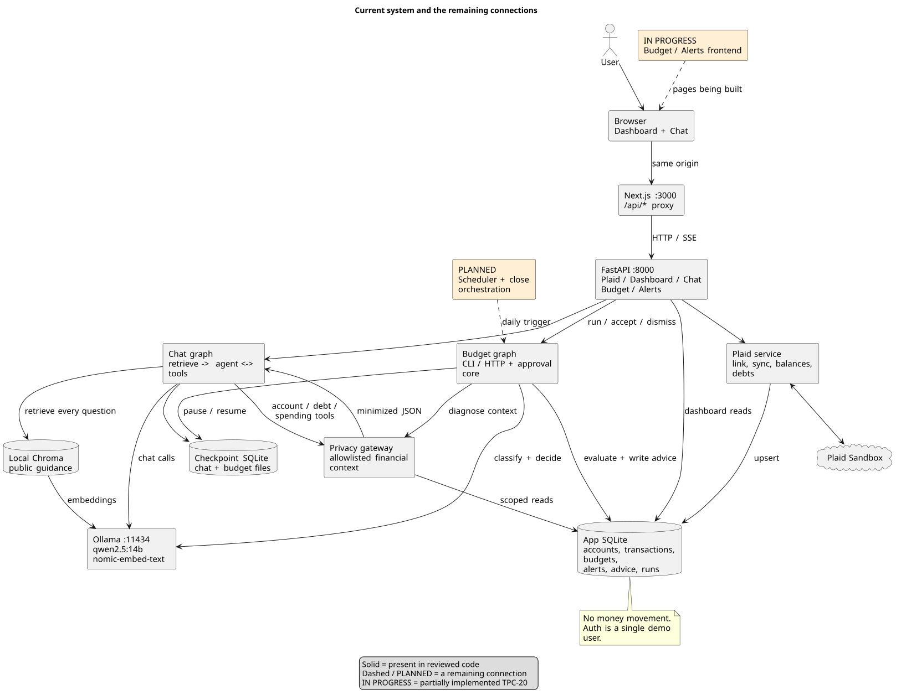
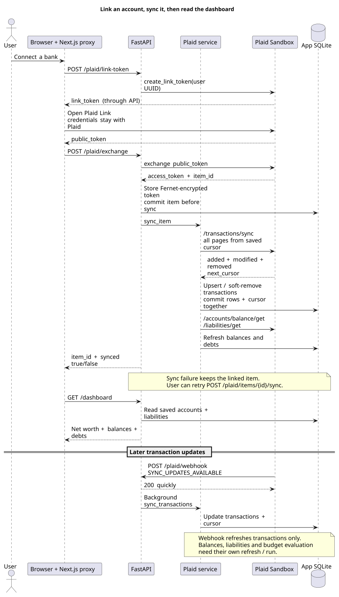
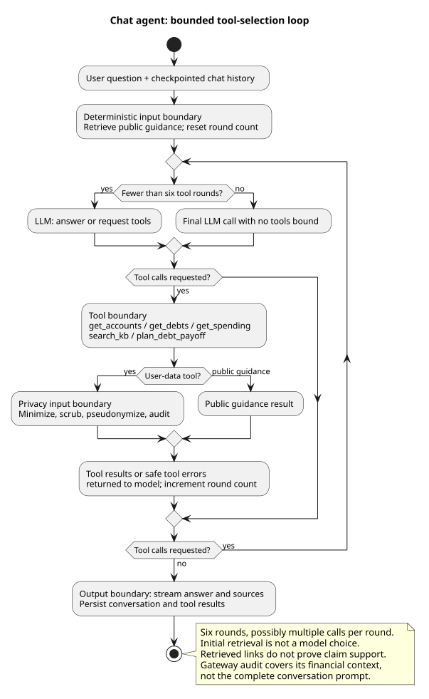
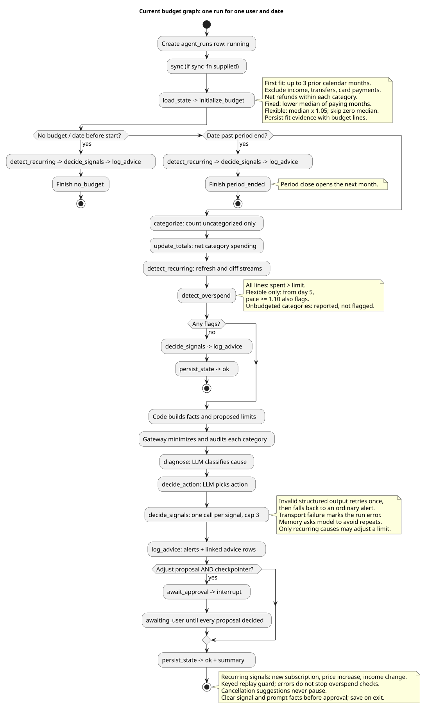
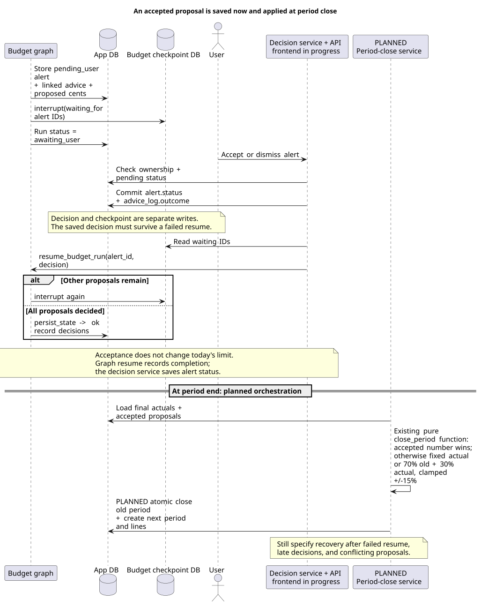
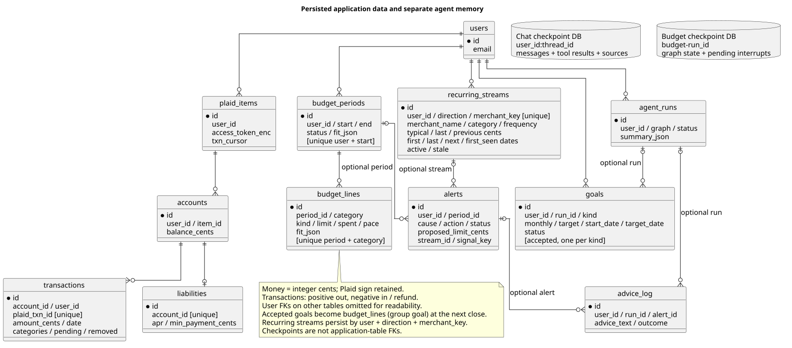
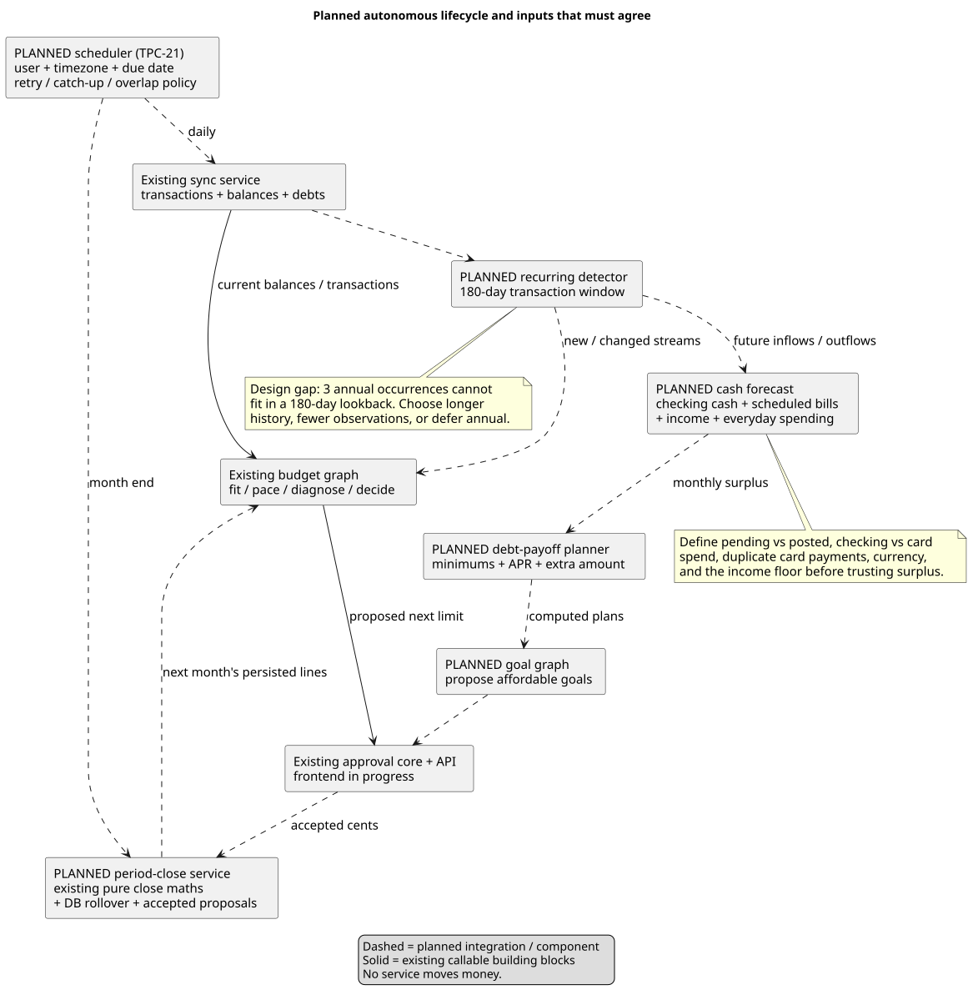
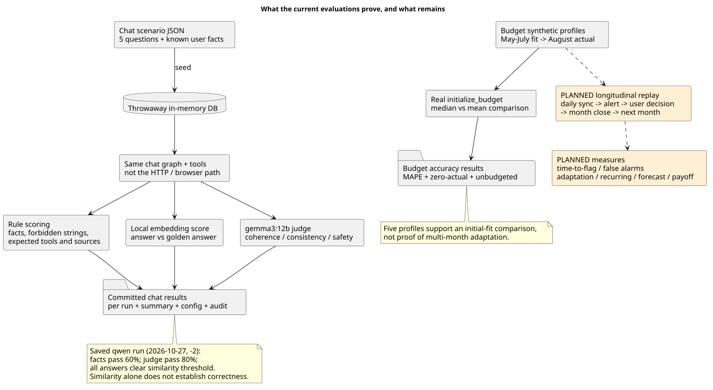

# How the system works, and what is still missing

For diagrams focused on AI reasoning, tool use, and autonomous behavior, see the [AI agent pipelines](agent-pipelines.md).

Review date: October 28, 2026. This walkthrough compares the architecture, milestone specs/plans, test documentation, and saved evaluation results with the implementation. It does not verify current external financial rules or re-run live Plaid/Ollama tests.

**The main gap is completing the lifecycle.** The dashboard and chat work paths exist, and the budget engine and approval core exist. The system still needs the connections that make it autonomous across days and months: scheduling, recovery, period rollover, and applying accepted proposals. Several features in the architecture are designs rather than implemented components.

The workspace was actively changing during review. Approval/memory code and `budget_service/alerts.py` were present at commit `ba3587c`; by the final implementation check (`22eec53`), the Budget/Alerts routers were also registered. Frontend integration was still in progress. Treat TPC-20 as partially complete. Generated graph data captures the earlier files read during this review, rather than an atomic Git snapshot, and does not include the later API additions.

## 1. The whole system



The browser calls the Next.js server, which proxies `/api/*` to FastAPI. Financial data comes from Plaid into the application database. Dashboard reads use that saved data. Chat retrieves public guidance from Chroma and private facts through the privacy gateway. The budget graph runs from its CLI or the Budget API and persists results in the same application database.

Local storage has distinct responsibilities: the app database stores business records, Chroma stores public guidance vectors, checkpoint databases store graph execution state, and JSONL files record financial contexts built by the gateway. The app does not currently contain a financial knowledge graph; LangGraph is an execution graph and Chroma provides vector retrieval. The separately generated `graphify-out/` is a development aid, not an application component.

Evidence: [API registration](../backend/app/main.py), [proxy](../frontend/next.config.ts), [models](../backend/app/db/models.py), [chat graph](../backend/app/agents/chat_graph.py), [budget graph](../backend/app/agents/budget_graph.py).

| Capability | Reviewed state | Remaining work |
|---|---|---|
| Plaid link, sync, dashboard | Implemented | Freshness visibility, webhook verification and concurrency handling |
| Chat, four tools, local RAG, SSE, persisted conversations | Implemented | Spending consistency, factual reliability, context growth policy |
| Initial budget, pace, diagnosis, proposed limits | Implemented | Fresh-data bootstrap ordering; uncategorized and unbudgeted policy |
| Advice memory, graph pause/resume, decision service, Budget/Alerts APIs | Backend implemented; TPC-20 in progress | Frontend integration and recovery contract |
| Daily scheduler | Planned TPC-21 | Due-job policy, user timezone, overlap, missed runs and restart recovery |
| Period close | Pure adjustment function implemented | TPC-22 orchestration: persist close and open next month atomically |
| Recurring detection, cash forecast, debt simulation, goals | Planned | Implement functions, tables, tools, UI and evaluations |
| Evaluation | Chat and initial-budget harnesses implemented | Longitudinal budget replay and explicit quality gates |

## 2. Linking and keeping bank data fresh



The access token is encrypted and committed before the first sync. A failed sync therefore means “linked, retry sync,” rather than losing the connection. Transaction rows and the transaction cursor commit together, making repeated completed syncs safe. `sync_item` also refreshes balances and liabilities, but the webhook's background path only calls `sync_transactions`.

**Missing connection:** a new transaction webhook does not itself refresh all balances, recalculate budget pace, or run diagnosis. The scheduler must establish when those happen and expose stale/partial results. A budget run can record sync errors and still finish `ok` against saved data.

**Readiness items already acknowledged in the repo:** the webhook trusts its payload pending JWT verification; manual and webhook syncs of the same item can race. These are local-demo limitations, with different urgency if the webhook becomes publicly reachable. Real authentication is also intentionally deferred.

Evidence: [Plaid routes](../backend/app/api/plaid.py), [sync service](../backend/app/plaid_service/sync.py), [webhook handler](../backend/app/plaid_service/webhooks.py), [documented sync gaps](tests/test_sync.md), [demo identity](../backend/app/api/deps.py).

## 3. Chat, guidance, and the privacy boundary



Every question triggers retrieval before the model chooses tools. The four current tools are `get_accounts`, `get_debts`, `get_spending`, and `search_kb`. Account/debt/spending context passes through field allowlists, scrubbing and pseudonymization. Public guidance retrieval uses the local embedding model directly. A maximum of six tool rounds bounds the loop, and SSE keep-alives prevent the proxy timing out while the model is silent.

**Boundary to document accurately:** user messages and conversation history go directly into the local model prompt. The gateway audits the financial context it builds, not every full model prompt. Checkpoints also contain conversation and tool messages. The gateway limits database-derived exposure; it does not guarantee arbitrary personal names are removed from all text. A future hosted-model comparison needs a separate review of user text, retrieval queries, checkpoint contents and logging.

**Retrieval is not evidence of use.** The UI lists retrieved passages even when the answer does not substantively use them. The old `search_kb` tool description still asks for URLs, while the newer system prompt tells the model not to write URLs. Align those instructions and test unsupported questions and irrelevant retrieval.

**Source-year handling is missing.** The stored IRS comparison chart contains historical years while another stored IRA source includes 2026. Both have recent fetch dates. Add effective-year metadata and tests for current-year versus historical questions; “fetched recently” does not mean every number is for the current year.

Evidence: [chat graph](../backend/app/agents/chat_graph.py), [tools](../backend/app/agents/tools.py), [gateway](../backend/app/privacy/gateway.py), [chat API](../backend/app/api/chat.py), [scrubber limitations](tests/test_scrub.md), [stored comparison chart](../kb/sources/irs-roth-comparison-chart.md), [stored IRA limits](../kb/sources/irs-ira-contribution-limits.md).

## 4. One budget run



The design's strongest separation is already implemented: code computes limits, pace, evidence and proposed cents; the model classifies the cause and chooses an action. Invalid structured output retries once, then falls back to an ordinary alert. An unavailable model is different: transport exceptions propagate and mark the run `error`.

Current arithmetic and defaults:

- Fit up to three previous calendar months, excluding transfers, income and credit-card payments. Net refunds inside each category, with a floor of zero.
- Fixed limits use the lower median of months with a payment. Current default fixed primary categories are `RENT_AND_UTILITIES` and `LOAN_PAYMENTS`; automatically recognizing subscriptions as fixed awaits recurring detection.
- Flexible limits use the monthly median × 1.05. Zero-median categories are skipped. Outlier evidence explains the fit; it does not remove months and recompute the median.
- All lines flag when actual spending exceeds the limit. Flexible lines also flag from day five when pace reaches 1.10. Fixed bills are not judged by daily pace.
- Unbudgeted categories are listed but do not raise overspend alerts. Categorization currently counts missing categories rather than assigning them with an LLM.

**Bootstrap ordering needs a decision:** `load_state` initializes the budget before the graph's sync node. If there is no usable history, it exits `no_budget` without syncing. Linking currently provides a separate first sync, but a failed first sync means a later budget run alone cannot bootstrap the history. Sync first, or make a prerequisite/retry path explicit.

**Spending is not yet one shared concept.** Chat sums positive transactions and uses Plaid primary categories. The budget nets refunds, excludes transfers/card payments, and prefers `our_category`. Both loaders currently include pending, non-removed rows. Define the pending policy and align category/date/filter semantics before asserting that chat and budget totals agree. Also state a single-currency assumption or store currency before combining arbitrary accounts.

**Affordability is another design decision:** category medians independently estimate spending, but do not constrain the sum of limits to income or reserve a savings/debt allocation. Decide whether this is a spending forecast or an affordable allocation, then connect the income/forecast/goal work accordingly.

Evidence: [fitting](../backend/app/budget_engine/fit.py), [spending rules](../backend/app/budget_engine/txns.py), [pace](../backend/app/budget_engine/pace.py), [DB loader and initialization](../backend/app/budget_service/initialize.py), [graph](../backend/app/agents/budget_graph.py), [chat spending](../backend/app/privacy/gateway.py).

## 5. Approval is not application of a new limit



Only an `adjust_next_budget` proposal pauses a checkpointed run. Ordinary alerts and suggestions can be accepted/dismissed without pausing graph execution. The decision service saves the alert status and advice outcome before attempting to resume the graph. With multiple proposals, the graph waits until all have decisions. Accepting a proposal does not change the current budget line.

**Recovery mismatch:** the TPC-20 spec says a failed resume leaves the run `awaiting_user`, but `resume_budget_run` marks the run `error` when invocation raises; the decision service then catches and logs the exception. The decision remains saved. Choose the expected run status and provide a way to reconcile saved decisions with checkpoint state after restart or a failed resume.

**Deduplication is a model decision by design.** Memory prompts ask for `no_op` when an equal-severity alert already exists. That is not a database uniqueness guarantee; the invalid-output fallback can still write another ordinary alert. Keep the intended approach, but define and measure acceptable repeat behavior, escalation, dismissed suggestions, and repeat runs after failures.

**TPC-22 still needs the business transaction:** read final actuals and accepted `proposed_limit_cents`, close the old period, and write the next period and lines. The pure close function already gives accepted values precedence; otherwise fixed lines follow actuals (keeping the old limit on a zero month), and flexible lines use 70% old + 30% actual clamped to ±15%. Specify late acceptance, multiple accepted proposals for one category, missing months, and rerunning close without duplicating periods.

Evidence: [approval graph and resume](../backend/app/agents/budget_graph.py), [decision service](../backend/app/budget_service/alerts.py), [close arithmetic](../backend/app/budget_engine/close.py), [TPC-20 spec](superpowers/specs/2026-10-28-tpc-20-alerts-advice-memory-design.md).

**API now present:** `GET /budget` computes pace without writing; `POST /budget/run` starts background work and returns a run ID with HTTP 202; `GET /budget/runs/{id}` exposes status for polling. `GET /alerts` lists alerts, and accept/dismiss routes call the decision service. The frontend must handle running, waiting, error and no-budget states. The existing architecture's `GET /budget/current` is an older planned name, so the API inventory needs updating. Evidence: [budget router](../backend/app/api/budget.py), [alerts router](../backend/app/api/alerts.py).

## 6. What is stored where



The application schema already supports budgets, proposals, advice outcomes and agent run summaries. `advice_log.alert_id` connects a user decision to the advice that produced it. A budget line inherits its user through its period; ownership checks must follow that relationship. Goals and recurring streams in the architecture are planned tables, not present models.

**Operational decisions remain:** backup/restore the app DB, both checkpoint files and the encryption key consistently; choose retention/deletion rules for prompts and conversations; and reconcile incomplete runs after restart. Encrypting access tokens does not encrypt transaction history or checkpoint text. Locks currently assume one API worker; scheduling budget work alongside chat also needs a resource policy for the same local model.

Evidence: [models](../backend/app/db/models.py), [configuration paths](../backend/app/config.py), [chat locking](../backend/app/api/chat.py), [TPC-20 design](superpowers/specs/2026-10-28-tpc-20-alerts-advice-memory-design.md).

## 7. The planned autonomous lifecycle



This diagram is the target integration, not an implemented pipeline. Recurring streams feed cash flow; cash flow supplies an affordable surplus; debt simulation uses it; goals produce proposals; approvals feed period close. Scheduling and period close are prerequisites for demonstrating autonomous adaptation over several months.

Three design questions should be resolved before implementing the forecast and detector:

1. **Annual streams:** three annual charges cannot fit within a 180-day history window. Increase history, choose a different annual-detection rule, or defer annual support. Weekly/biweekly/semi-monthly tolerances also overlap; define how a stream gets exactly one cadence.
2. **Everyday spending:** say whether median daily spending includes zero-spend days, which account types contribute, and how card purchases and card payments avoid double counting. Quantile-based low/high paths need replay validation before they are described as calibrated uncertainty bands.
3. **Freshness and affordability:** define the snapshot time, pending policy, duplicate scheduled payment matching, missing income behavior, and which obligations are reserved before surplus is offered to goals. Cancellation acceptance should record a user commitment and verify later charges; the app cannot cancel the subscription itself.

Evidence: [architecture sections 6a.1–6a.4](architecture.md#6a-beyond-budgeting-recurring-charges-cash-flow-and-debt-payoff-milestones-3-4).

## 8. What the evaluations currently establish



The chat harness uses the actual graph/tools with synthetic users and a throwaway database. It tests agent behavior, not the browser/proxy/HTTP path. Initial-budget evaluation separately compares fitting methods against the next month's spending, without an LLM. These are useful foundations, and documented unit tests cover money/calendar edge cases, tool errors, SSE cleanup, approval order and initialization races.

**Saved results expose a reliability gap.** The second saved `qwen2.5:14b` run on October 27 has 15 runs: factual pass rate 60%, judge pass rate 80%, tool accuracy 80%, and 100% above the similarity threshold. The debt-priority scenario fails its full fact check in all three runs even though the judge passes it; the mixed debt/emergency scenario fails facts and data consistency. Inspect missing facts and tool use before interpreting the high similarity as success. These are saved historical results, not a fresh measurement of today's code.

**Missing validation:** multi-period replay covering daily updates → flags → decisions → close → next month; time-to-flag, false alarms, repeat alerts, missed-job recovery and adaptation; and later recurring/forecast/payoff benchmarks. The CLI intentionally exits successfully when an evaluation completes despite poor scores, so define a separate quality gate. Record skipped live checks explicitly rather than counting them as proof of behavior.

Evidence: [saved chat summary](../eval/results/2026-10-27/qwen2.5_14b-2/summary.json), [initial-budget results](../eval/results/2026-10-28/budget_accuracy/results.json), [eval instructions](../eval/README.md), [documented test coverage](tests/).

## Review checklist, in suggested order

- [ ] Finish and verify TPC-20 frontend integration with the existing APIs; keep the docs' route names and run statuses aligned with the implementation.
- [ ] Decide failed-resume behavior and reconcile saved decisions with checkpoints after failure/restart.
- [ ] Add TPC-21 scheduling with timezone, overlap, catch-up, retry and stale-data behavior.
- [ ] Add TPC-22 atomic period rollover; test repeated close, missed months and accepted proposals.
- [ ] Align chat/budget spending definitions and decide the bootstrap, pending and currency policies.
- [ ] Build a multi-month replay with decisions and failures, and define quality thresholds separately from process completion.
- [ ] Resolve the annual-stream and forecast-accounting issues before building those modules.
- [ ] Add tax-year-aware KB retrieval and a source refresh/conflict policy.
- [ ] Before expanding access beyond the demo, finish webhook verification and define auth, retention and recovery behavior.

Documentation cleanup also matters: mark superseded fixed-budget rules in historical specs, distinguish built/planned routes in architecture section 9, correct the “every prompt is audited” wording, and replace the scaffold frontend README. This walkthrough and its diagrams provide the current-state map without rewriting historical implementation plans.

## Diagram sources and regeneration

All eight diagrams have editable `.puml` sources beside their `.svg` and `.png` renders in [diagrams/](diagrams/). With PlantUML and Graphviz installed, run from the repository root:

```bash
plantuml -tsvg -failfast2 docs/diagrams/*.puml
plantuml -tpng -failfast2 docs/diagrams/*.puml
```
